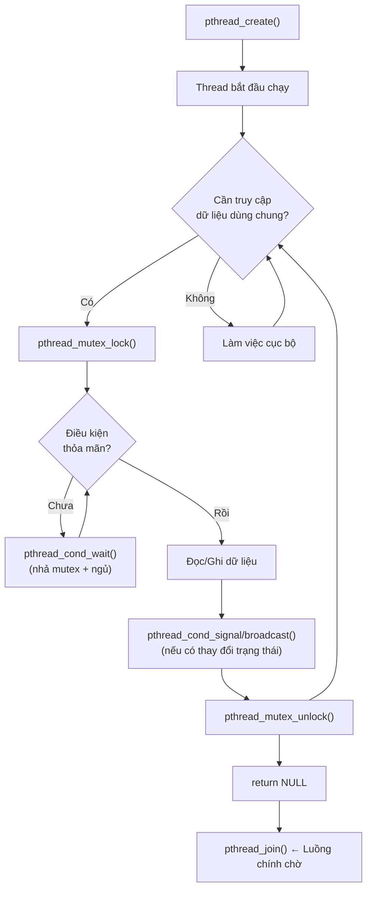

# Lab 10 – Đồng Bộ Hóa & Lập Trình Đồng Thời

> **Biên dịch chuẩn:** `gcc -Wall -Wextra -std=c11 -pthread file.c -o file`
> **Debug race condition:** `gcc -Wall -Wextra -std=c11 -pthread -fsanitize=thread -g file.c -o file_tsan`

---

## 1. MUTEX — Bảo vệ miền tới hạn

### Khai báo & Khởi tạo

```c
#include <pthread.h>

// Cách 1: Khởi tạo tĩnh (đơn giản nhất)
pthread_mutex_t mutex = PTHREAD_MUTEX_INITIALIZER;

// Cách 2: Khởi tạo động (dùng khi mutex nằm trong struct)
pthread_mutex_t mutex;
pthread_mutex_init(&mutex, NULL);  // NULL = thuộc tính mặc định
```

### Khóa / Mở khóa

```c
pthread_mutex_lock(&mutex);    // Chặn cho đến khi lấy được khóa
/* === MIỀN TỚI HẠN (Critical Section) === */
counter++;
/* ======================================= */
pthread_mutex_unlock(&mutex);  // Luôn mở khóa sau khi xong
```

### Hủy mutex (khi dùng init động)

```c
pthread_mutex_destroy(&mutex);  // Chỉ gọi khi KHÔNG còn thread nào dùng
```

### Pattern đầy đủ: Shared counter an toàn

```c
#include <pthread.h>
#include <stdio.h>

#define LOOPS 1000000
static long counter = 0;
static pthread_mutex_t mutex = PTHREAD_MUTEX_INITIALIZER;

void *worker(void *arg) {
    for (long i = 0; i < LOOPS; i++) {
        pthread_mutex_lock(&mutex);
        counter++;
        pthread_mutex_unlock(&mutex);
    }
    return NULL;
}

int main(void) {
    pthread_t t1, t2;
    pthread_create(&t1, NULL, worker, NULL);
    pthread_create(&t2, NULL, worker, NULL);
    pthread_join(t1, NULL);
    pthread_join(t2, NULL);
    printf("Expected: %d | Got: %ld\n", 2 * LOOPS, counter);  // Luôn đúng
    return 0;
}
```

> [!IMPORTANT]
> **Quy tắc vàng:** Giữ miền tới hạn **ngắn nhất có thể**. Tính toán nặng → làm ở biến cục bộ → chỉ lock khi ghi kết quả vào biến dùng chung.

```c
// ĐÚNG: Tính trước ngoài lock
long local = compute_expensive();
pthread_mutex_lock(&mutex);
shared_total += local;
pthread_mutex_unlock(&mutex);

// SAI: Tính trong lock → chặn các thread khác quá lâu
pthread_mutex_lock(&mutex);
shared_total += compute_expensive();  // BAD
pthread_mutex_unlock(&mutex);
```

---

## 2. BIẾN ĐIỀU KIỆN (Condition Variable) — Chờ trạng thái

> [!NOTE]
> **Vì sao cần?** Mutex chỉ bảo vệ dữ liệu. Khi thread cần **chờ một điều kiện** (ví dụ bộ đệm rỗng thì consumer phải chờ), không thể dùng vòng lặp `while(cond){}` vì gây lãng phí CPU (busy waiting).

### Khai báo & Khởi tạo

```c
// Tĩnh
pthread_cond_t not_empty = PTHREAD_COND_INITIALIZER;

// Động
pthread_cond_t not_empty;
pthread_cond_init(&not_empty, NULL);
```

### Hàm cốt lõi

| Hàm | Ý nghĩa |
|-----|---------|
| `pthread_cond_wait(&cond, &mutex)` | Mở mutex + ngủ; khi thức dậy tự khóa lại mutex |
| `pthread_cond_signal(&cond)` | Đánh thức **ít nhất 1** thread đang chờ |
| `pthread_cond_broadcast(&cond)` | Đánh thức **tất cả** thread đang chờ |
| `pthread_cond_destroy(&cond)` | Hủy biến điều kiện |

### Pattern chuẩn: Consumer chờ dữ liệu

```c
// === BÊN CONSUMER ===
pthread_mutex_lock(&mutex);
while (ready == 0) {                          // ⚠️ PHẢI dùng while, KHÔNG dùng if
    pthread_cond_wait(&cond, &mutex);         // Nhả mutex + ngủ
}
// ready == 1, an toàn truy cập dữ liệu
printf("Consumer: Data received.\n");
pthread_mutex_unlock(&mutex);

// === BÊN PRODUCER ===
pthread_mutex_lock(&mutex);
ready = 1;                                    // Thay đổi trạng thái dùng chung
pthread_cond_signal(&cond);                   // Đánh thức consumer
pthread_mutex_unlock(&mutex);
```

> [!CAUTION]
> **Luôn dùng `while`, KHÔNG dùng `if`** quanh `pthread_cond_wait()`. Lý do: sau khi thức dậy, thread khác có thể đã thay đổi trạng thái trước khi thread này lấy lại mutex. POSIX cũng cho phép "spurious wakeup" (thức dậy giả).

### Pattern: Bộ đệm hữu hạn hoàn chỉnh

```c
#define CAPACITY 5
int buffer[CAPACITY];
int head = 0, tail = 0, count = 0;

pthread_mutex_t mutex = PTHREAD_MUTEX_INITIALIZER;
pthread_cond_t not_empty = PTHREAD_COND_INITIALIZER;
pthread_cond_t not_full  = PTHREAD_COND_INITIALIZER;

// --- Producer: Thêm phần tử ---
void produce(int value) {
    pthread_mutex_lock(&mutex);
    while (count == CAPACITY) {               // Buffer đầy → chờ
        pthread_cond_wait(&not_full, &mutex);
    }
    buffer[tail] = value;
    tail = (tail + 1) % CAPACITY;
    count++;
    pthread_cond_signal(&not_empty);          // Báo consumer có dữ liệu
    pthread_mutex_unlock(&mutex);
}

// --- Consumer: Lấy phần tử ---
int consume(void) {
    pthread_mutex_lock(&mutex);
    while (count == 0) {                      // Buffer rỗng → chờ
        pthread_cond_wait(&not_empty, &mutex);
    }
    int value = buffer[head];
    head = (head + 1) % CAPACITY;
    count--;
    pthread_cond_signal(&not_full);           // Báo producer có chỗ trống
    pthread_mutex_unlock(&mutex);
    return value;
}
```

### Pattern: Kết thúc Producer–Consumer (cờ `closed`)

```c
int closed = 0;  // Biến dùng chung, bảo vệ bởi mutex

// Producer cuối cùng: đặt closed và broadcast
pthread_mutex_lock(&mutex);
closed = 1;
pthread_cond_broadcast(&not_empty);  // Đánh thức TẤT CẢ consumer đang ngủ
pthread_mutex_unlock(&mutex);

// Consumer: kiểm tra closed để thoát
pthread_mutex_lock(&mutex);
while (count == 0 && !closed) {
    pthread_cond_wait(&not_empty, &mutex);
}
if (count == 0 && closed) {
    pthread_mutex_unlock(&mutex);
    return NULL;  // Không còn dữ liệu và đã đóng → thoát
}
// Lấy dữ liệu...
pthread_mutex_unlock(&mutex);
```

---

## 3. SEMAPHORE — Giới hạn số lượng tài nguyên đồng thời

> [!NOTE]
> Semaphore lưu một **bộ đếm không âm**. Khác với mutex (chỉ 0/1), semaphore đếm được nhiều hơn. Dùng khi cần giới hạn số thread được vào một vùng đồng thời.

### Khai báo & Khởi tạo

```c
#include <semaphore.h>

sem_t slots;
sem_init(&slots, 0, 2);  // 0 = trong cùng process, 2 = tối đa 2 thread cùng vào
```

### Hàm cốt lõi

| Hàm | Ý nghĩa |
|-----|---------|
| `sem_wait(&sem)` | Giảm đếm; nếu đếm = 0 → chặn (chờ) |
| `sem_post(&sem)` | Tăng đếm; đánh thức 1 thread đang chờ (nếu có) |
| `sem_destroy(&sem)` | Hủy semaphore |

### Pattern: Giới hạn tối đa K thread đồng thời

```c
#include <pthread.h>
#include <semaphore.h>
#include <stdio.h>
#include <unistd.h>

#define NUM_THREADS 5
#define MAX_CONCURRENT 2

sem_t slots;

void *task(void *arg) {
    int id = *(int *)arg;
    printf("Thread %d waiting.\n", id);
    sem_wait(&slots);                         // Lấy 1 slot; nếu hết thì chờ
    printf("Thread %d entered.\n", id);
    usleep(200000);                           // Mô phỏng công việc
    printf("Thread %d leaving.\n", id);
    sem_post(&slots);                         // Trả lại 1 slot
    return NULL;
}

int main(void) {
    sem_init(&slots, 0, MAX_CONCURRENT);
    pthread_t threads[NUM_THREADS];
    int ids[NUM_THREADS];
    for (int i = 0; i < NUM_THREADS; i++) {
        ids[i] = i + 1;
        pthread_create(&threads[i], NULL, task, &ids[i]);
    }
    for (int i = 0; i < NUM_THREADS; i++)
        pthread_join(threads[i], NULL);
    sem_destroy(&slots);
    return 0;
}
```

---

## 4. DEADLOCK — Tạo và phòng tránh

> [!CAUTION]
> **Deadlock:** Hai thread A và B đều đang giữ một khóa và chờ khóa của nhau → không thread nào tiến triển.

### Pattern gây deadlock (đừng làm vậy)

```c
pthread_mutex_t mutexA = PTHREAD_MUTEX_INITIALIZER;
pthread_mutex_t mutexB = PTHREAD_MUTEX_INITIALIZER;

// Thread 1: Lấy A rồi B
void *thread1(void *arg) {
    pthread_mutex_lock(&mutexA);
    usleep(1000);               // Tăng khả năng deadlock
    pthread_mutex_lock(&mutexB);  // ❌ Thread 2 đang giữ B → DEADLOCK
    /* work */
    pthread_mutex_unlock(&mutexB);
    pthread_mutex_unlock(&mutexA);
    return NULL;
}

// Thread 2: Lấy B rồi A ← THỨ TỰ NGƯỢC!
void *thread2(void *arg) {
    pthread_mutex_lock(&mutexB);
    usleep(1000);
    pthread_mutex_lock(&mutexA);  // ❌ Thread 1 đang giữ A → DEADLOCK
    /* work */
    pthread_mutex_unlock(&mutexA);
    pthread_mutex_unlock(&mutexB);
    return NULL;
}
```

### ✅ Sửa: Thống nhất thứ tự khóa (Lock Ordering)

```c
// Cả hai thread đều khóa theo thứ tự A → B
void *thread1(void *arg) {
    pthread_mutex_lock(&mutexA);  // Luôn A trước
    pthread_mutex_lock(&mutexB);  // Rồi mới B
    /* work */
    pthread_mutex_unlock(&mutexB);
    pthread_mutex_unlock(&mutexA);
    return NULL;
}

void *thread2(void *arg) {
    pthread_mutex_lock(&mutexA);  // Luôn A trước ← CÙNG THỨ TỰ
    pthread_mutex_lock(&mutexB);
    /* work */
    pthread_mutex_unlock(&mutexB);
    pthread_mutex_unlock(&mutexA);
    return NULL;
}
```

> [!TIP]
> **4 điều kiện cần để xảy ra Deadlock:** Loại trừ lẫn nhau + Giữ và chờ + Không cưỡng đoạt + Chờ vòng. Phá bỏ **một** trong bốn điều kiện là đủ để ngăn deadlock. Thứ tự khóa thống nhất phá điều kiện "Chờ vòng".

---

## 5. THREAD-SAFE QUEUE — Hàng đợi vòng an toàn

### Struct và khởi tạo

```c
#define QUEUE_SIZE 16

typedef struct {
    int data[QUEUE_SIZE];
    int head;
    int tail;
    int count;
    pthread_mutex_t mutex;
    // Thêm nếu cần chờ:
    pthread_cond_t not_empty;
    pthread_cond_t not_full;
} WorkQueue;

void queue_init(WorkQueue *q) {
    q->head = q->tail = q->count = 0;
    pthread_mutex_init(&q->mutex, NULL);
    pthread_cond_init(&q->not_empty, NULL);
    pthread_cond_init(&q->not_full, NULL);
}

void queue_destroy(WorkQueue *q) {
    pthread_mutex_destroy(&q->mutex);
    pthread_cond_destroy(&q->not_empty);
    pthread_cond_destroy(&q->not_full);
}
```

### Push / Pop (không chờ, trả lỗi nếu đầy/rỗng)

```c
int queue_push(WorkQueue *q, int value) {
    pthread_mutex_lock(&q->mutex);
    if (q->count == QUEUE_SIZE) {
        pthread_mutex_unlock(&q->mutex);
        return -1;  // Đầy
    }
    q->data[q->tail] = value;
    q->tail = (q->tail + 1) % QUEUE_SIZE;
    q->count++;
    pthread_cond_signal(&q->not_empty);
    pthread_mutex_unlock(&q->mutex);
    return 0;
}

int queue_pop(WorkQueue *q, int *value) {
    pthread_mutex_lock(&q->mutex);
    if (q->count == 0) {
        pthread_mutex_unlock(&q->mutex);
        return -1;  // Rỗng
    }
    *value = q->data[q->head];
    q->head = (q->head + 1) % QUEUE_SIZE;
    q->count--;
    pthread_cond_signal(&q->not_full);
    pthread_mutex_unlock(&q->mutex);
    return 0;
}
```

### Push / Pop có chờ (blocking)

```c
void queue_push_wait(WorkQueue *q, int value) {
    pthread_mutex_lock(&q->mutex);
    while (q->count == QUEUE_SIZE)                   // Chờ nếu đầy
        pthread_cond_wait(&q->not_full, &q->mutex);
    q->data[q->tail] = value;
    q->tail = (q->tail + 1) % QUEUE_SIZE;
    q->count++;
    pthread_cond_signal(&q->not_empty);
    pthread_mutex_unlock(&q->mutex);
}

int queue_pop_wait(WorkQueue *q) {
    pthread_mutex_lock(&q->mutex);
    while (q->count == 0)                            // Chờ nếu rỗng
        pthread_cond_wait(&q->not_empty, &q->mutex);
    int value = q->data[q->head];
    q->head = (q->head + 1) % QUEUE_SIZE;
    q->count--;
    pthread_cond_signal(&q->not_full);
    pthread_mutex_unlock(&q->mutex);
    return value;
}
```

---

## 6. FLOW — Luồng thực thi điển hình



---

## 7. BẢNG SO SÁNH CÁC CƠ CHẾ

| Cơ chế | Dùng khi | API chính |
|--------|----------|-----------|
| `pthread_mutex_t` | Bảo vệ miền tới hạn, 1 thread vào tại một thời điểm | `lock` / `unlock` |
| `pthread_cond_t` | Chờ một điều kiện thay đổi (cần dùng kèm mutex) | `wait` / `signal` / `broadcast` |
| `sem_t` | Giới hạn K thread đồng thời, đếm sự kiện/slot | `sem_wait` / `sem_post` |

---

## 8. LỖI THƯỜNG GẶP & CÁCH KIỂM TRA

| Hiện tượng | Nguyên nhân | Cách sửa |
|------------|-------------|----------|
| Kết quả sai dù có mutex | Không phải mọi truy cập đều dùng **cùng** mutex | Liệt kê tất cả nơi đọc/ghi biến dùng chung |
| Chương trình bị treo | Deadlock hoặc thread chờ điều kiện không bao giờ được báo | Kiểm tra thứ tự lock; kiểm tra `signal`/`broadcast` |
| CPU cao khi không làm gì | Busy waiting | Dùng `pthread_cond_wait()` hoặc `sem_wait()` |
| Thread thức nhưng dữ liệu chưa sẵn | Dùng `if` thay vì `while` quanh `cond_wait` | Đổi thành `while` |
| Không thoát được khi kết thúc | Không có cờ `closed` hoặc quên `broadcast` | Thêm `closed=1` + `pthread_cond_broadcast()` |

---

## 9. LỆNH BIÊN DỊCH & CHẠY

```bash
# Biên dịch chuẩn
gcc -Wall -Wextra -std=c11 -pthread ex1.c -o ex1 && ./ex1

# Biên dịch tất cả ex1–ex6
for i in {1..6}; do gcc -Wall -Wextra -std=c11 -pthread "ex${i}.c" -o "ex${i}" && echo "ex${i} OK"; done

# Chạy nhiều lần để phát hiện lỗi không ổn định
for i in {1..5}; do ./ex1; done

# Debug race condition bằng ThreadSanitizer
gcc -Wall -Wextra -std=c11 -pthread -fsanitize=thread -g ex1.c -o ex1_tsan && ./ex1_tsan

# Dọn dẹp
rm -f ex1 ex2 ex3 ex4 ex5 ex6 ex1_tsan
```
