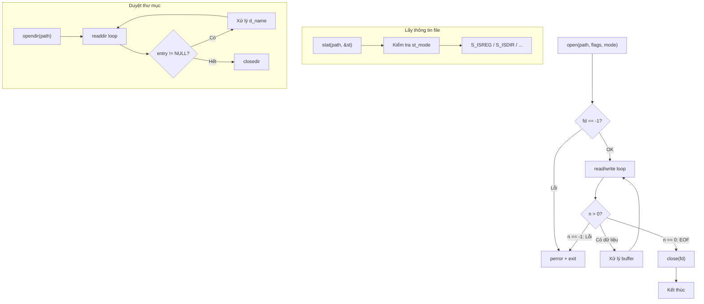

# Lab 5 — File I/O Mức Thấp (Low-level I/O)

> [!IMPORTANT]
> **Lệnh biên dịch chuẩn:**
> ```bash
> gcc -Wall -Wextra -std=c11 -D_POSIX_C_SOURCE=200809L file.c -o file
> ```
> `-D_POSIX_C_SOURCE=200809L` bắt buộc để dùng `openat`, `dirfd`, và một số hàm POSIX.

---

## 1. `open()` — Mở/Tạo File

```c
#include <fcntl.h>
#include <sys/stat.h>

int fd = open("file.txt", O_RDONLY);               // Chỉ đọc
int fd = open("out.txt", O_WRONLY | O_CREAT | O_TRUNC, 0644); // Ghi đè
int fd = open("log.txt", O_WRONLY | O_CREAT | O_APPEND, 0644); // Nối thêm
if (fd == -1) { perror("open"); exit(1); }
```

| Flag | Ý nghĩa |
|------|---------|
| `O_RDONLY` | Chỉ đọc |
| `O_WRONLY` | Chỉ ghi |
| `O_RDWR` | Đọc + ghi |
| `O_CREAT` | Tạo file nếu chưa tồn tại (cần `mode`) |
| `O_TRUNC` | Xóa nội dung cũ khi mở |
| `O_APPEND` | Ghi vào cuối file |
| `O_EXCL` | Lỗi nếu file đã tồn tại (dùng với `O_CREAT`) |

> [!NOTE]
> `mode` là quyền truy cập (ví dụ `0644`). Quyền thực tế = `mode & ~umask`.
> Chỉ cần truyền `mode` khi có `O_CREAT`.

---

## 2. `read()` / `write()` — Đọc/Ghi

```c
#include <unistd.h>

ssize_t n = read(fd, buf, sizeof(buf));  // Trả về số byte đọc được, 0=EOF, -1=lỗi
ssize_t n = write(fd, buf, len);         // Trả về số byte đã ghi, -1=lỗi
```

### Pattern đọc hết file (copy_fd):

```c
char buf[4096];
ssize_t n;
while ((n = read(fd_in, buf, sizeof(buf))) > 0) {
    ssize_t written = 0;
    while (written < n) {              // write loop — tránh partial write
        ssize_t w = write(fd_out, buf + written, n - written);
        if (w == -1) { perror("write"); exit(1); }
        written += w;
    }
}
if (n == -1) { perror("read"); exit(1); }
```

> [!CAUTION]
> `write()` có thể ghi ít hơn yêu cầu (partial write). **Luôn dùng vòng lặp write** khi ghi toàn bộ dữ liệu.

---

## 3. `lseek()` — Di Chuyển Con Trỏ File

```c
#include <unistd.h>

off_t pos = lseek(fd, offset, whence);
```

| `whence` | Ý nghĩa |
|----------|---------|
| `SEEK_SET` | Từ đầu file: `pos = offset` |
| `SEEK_CUR` | Từ vị trí hiện tại: `pos = cur + offset` |
| `SEEK_END` | Từ cuối file: `pos = size + offset` |

```c
// Lấy kích thước file
off_t size = lseek(fd, 0, SEEK_END);
lseek(fd, 0, SEEK_SET);   // Quay về đầu

// Truy cập bản ghi thứ k (0-indexed) trong file nhị phân
lseek(fd, (off_t)k * sizeof(Record), SEEK_SET);
```

---

## 4. `close()` — Đóng File

```c
if (close(fd) == -1) { perror("close"); }
```

> [!IMPORTANT]
> Luôn `close()` khi xong. Mỗi tiến trình có giới hạn số fd mở (thường 1024).

---

## 5. `stat()` / `lstat()` / `fstat()` — Thông Tin File

```c
#include <sys/stat.h>

struct stat st;
stat("file.txt", &st);    // Theo symlink
lstat("link.txt", &st);   // KHÔNG theo symlink (trả về info của link)
fstat(fd, &st);            // Dùng fd đã mở
```

### Các trường quan trọng của `struct stat`:

| Trường | Kiểu | Ý nghĩa |
|--------|------|---------|
| `st_mode` | `mode_t` | Loại file + quyền |
| `st_size` | `off_t` | Kích thước (byte) |
| `st_nlink` | `nlink_t` | Số hard link |
| `st_uid` / `st_gid` | `uid_t` / `gid_t` | Owner / Group |
| `st_atime` | `time_t` | Lần truy cập cuối |
| `st_mtime` | `time_t` | Lần sửa cuối |
| `st_ino` | `ino_t` | Inode number |
| `st_dev` | `dev_t` | Device ID |

### Kiểm tra loại file — dùng macro (KHÔNG dùng `S_IFMT` với `-std=c11`):

```c
if (S_ISREG(st.st_mode))  printf("Regular file\n");
if (S_ISDIR(st.st_mode))  printf("Directory\n");
if (S_ISLNK(st.st_mode))  printf("Symlink\n");   // chỉ đúng với lstat
if (S_ISFIFO(st.st_mode)) printf("FIFO\n");
if (S_ISCHR(st.st_mode))  printf("Char device\n");
if (S_ISBLK(st.st_mode))  printf("Block device\n");
```

### In quyền theo kiểu `ls -l`:

```c
printf("%c", S_ISDIR(st.st_mode) ? 'd' : '-');
printf("%c", (st.st_mode & S_IRUSR) ? 'r' : '-');
printf("%c", (st.st_mode & S_IWUSR) ? 'w' : '-');
printf("%c", (st.st_mode & S_IXUSR) ? 'x' : '-');
// tương tự cho group (S_IRGRP, S_IWGRP, S_IXGRP)
// và others (S_IROTH, S_IWOTH, S_IXOTH)
```

---

## 6. `opendir()` / `readdir()` / `closedir()` — Duyệt Thư Mục

```c
#include <dirent.h>

DIR *dir = opendir(".");
if (dir == NULL) { perror("opendir"); exit(1); }

struct dirent *entry;
errno = 0;
while ((entry = readdir(dir)) != NULL) {
    if (strcmp(entry->d_name, ".") == 0 || strcmp(entry->d_name, "..") == 0)
        continue;
    printf("%s\n", entry->d_name);
    errno = 0;    // Reset trước mỗi lần gọi readdir
}
if (errno != 0) { perror("readdir"); }

closedir(dir);
```

> [!NOTE]
> `readdir()` trả về `NULL` cả khi hết entry lẫn khi lỗi. Set `errno = 0` trước để phân biệt.

| Trường `dirent` | Ý nghĩa |
|----------------|---------|
| `d_name` | Tên file/thư mục |
| `d_ino` | Inode number |
| `d_type` | Loại (DT_REG, DT_DIR, DT_LNK...) — không khả dụng trên mọi hệ thống |

---

## 7. `mkdir()` / `rmdir()` / `chdir()`

```c
#include <sys/stat.h>  // mkdir
#include <unistd.h>    // rmdir, chdir

mkdir("newdir", 0755);     // Tạo thư mục
rmdir("emptydir");          // Xóa thư mục rỗng
chdir("/home/user");        // Đổi thư mục làm việc của tiến trình hiện tại
```

> [!CAUTION]
> `chdir()` chỉ ảnh hưởng đến tiến trình đang chạy, **không ảnh hưởng shell cha**. Đó là lý do `cd` phải là shell builtin chứ không phải chương trình riêng.

---

## 8. Flow Diagram



---

## 9. Hướng Dẫn Từng Bài

### Bài 1 — Đọc và in nội dung file

**Ý tưởng:** `open` → vòng lặp `read` → `write(STDOUT_FILENO, ...)` → `close`

```c
int fd = open(argv[1], O_RDONLY);
char buf[4096]; ssize_t n;
while ((n = read(fd, buf, sizeof(buf))) > 0)
    write(STDOUT_FILENO, buf, n);
close(fd);
```

**Biên dịch & chạy:**
```bash
gcc -Wall -Wextra -std=c11 -D_POSIX_C_SOURCE=200809L ex1.c -o ex1 && ./ex1 test.txt
```

---

### Bài 2 — Tạo file và ghi dữ liệu

**Ý tưởng:** `open` với `O_WRONLY|O_CREAT|O_TRUNC` → `write` → `close`

```c
int fd = open("output.txt", O_WRONLY | O_CREAT | O_TRUNC, 0644);
const char *msg = "Hello, file!\n";
write(fd, msg, strlen(msg));
close(fd);
```

---

### Bài 3 — `stat`: In thông tin file

**Ý tưởng:** `lstat(argv[1], &st)` → in `st_size`, `st_nlink`, `st_mode`

```c
struct stat st;
if (lstat(argv[1], &st) == -1) { perror("lstat"); exit(1); }
printf("Size: %lld\n", (long long)st.st_size);
printf("Links: %lu\n", (unsigned long)st.st_nlink);
printf("Type: %s\n", S_ISREG(st.st_mode) ? "file" : S_ISDIR(st.st_mode) ? "dir" : "other");
```

---

### Bài 4 — `linuxecho`: In tham số ra stdout

**Ý tưởng:** Duyệt `argv[1..argc-1]`, `write` từng arg + space/newline

```c
for (int i = 1; i < argc; i++) {
    write(STDOUT_FILENO, argv[i], strlen(argv[i]));
    if (i < argc - 1) write(STDOUT_FILENO, " ", 1);
}
write(STDOUT_FILENO, "\n", 1);
```

---

### Bài 5 — `linuxgrep`: Tìm dòng chứa pattern

**Ý tưởng:** Đọc file theo từng ký tự hoặc dòng (dùng `read` + tự buffer), tìm chuỗi với `strstr()`

```c
// Đọc từng dòng vào buffer, kiểm tra strstr(line, pattern)
char line[1024]; int len = 0;
char ch; ssize_t n;
while ((n = read(fd, &ch, 1)) > 0) {
    line[len++] = ch;
    if (ch == '\n') {
        line[len] = '\0';
        if (strstr(line, pattern)) write(STDOUT_FILENO, line, len);
        len = 0;
    }
}
```

---

### Bài 6 — `grepdir`: Tìm pattern trong thư mục (nâng cao)

**Ý tưởng:** `opendir` → `readdir` → `stat` từng entry → nếu regular file thì `grep` → đệ quy nếu là thư mục

---

### Bài 7 — `linuxls`: Liệt kê thư mục

**Ý tưởng:** `opendir(argv[1] hoặc ".")` → `readdir` loop → in `d_name`

```c
DIR *dir = opendir(argc > 1 ? argv[1] : ".");
struct dirent *e;
while ((e = readdir(dir)) != NULL) {
    if (e->d_name[0] == '.') continue;  // bỏ file ẩn
    printf("%s\n", e->d_name);
}
closedir(dir);
```

---

### Bài 8 — `linuxcd`: Mô phỏng lệnh cd

**Ý tưởng:** `chdir(argv[1])` → `getcwd(buf, sizeof(buf))` → in đường dẫn mới

```c
if (chdir(argv[1]) == -1) { perror("chdir"); exit(1); }
char cwd[1024];
getcwd(cwd, sizeof(cwd));
printf("Đã chuyển đến: %s\n", cwd);
```

> [!NOTE]
> Chương trình này không thay đổi thư mục của shell cha — chỉ minh họa API `chdir()`.

---

### Bài 9 — `linuxmkdir`: Tạo thư mục

```c
if (mkdir(argv[1], 0755) == -1) { perror("mkdir"); exit(1); }
printf("Đã tạo thư mục: %s\n", argv[1]);
```

---

### Bài 10 — `linuxrmdir`: Xóa thư mục

```c
if (rmdir(argv[1]) == -1) { perror("rmdir"); exit(1); }
printf("Đã xóa thư mục: %s\n", argv[1]);
```

> [!NOTE]
> `rmdir()` chỉ xóa được thư mục **rỗng**. Nếu thư mục có file → `ENOTEMPTY`.

---

## 10. Bảng Lỗi Thường Gặp

| Lỗi | Nguyên nhân | Cách sửa |
|-----|------------|----------|
| `ENOENT` | File không tồn tại | Kiểm tra đường dẫn |
| `EACCES` | Không có quyền | `chmod` hoặc `sudo` |
| `EBADF` | fd không hợp lệ | Kiểm tra `open()` thành công trước |
| `ENOTDIR` | Dùng thư mục như file | Dùng `S_ISDIR()` để kiểm tra trước |
| `ENOTEMPTY` | `rmdir` trên thư mục không rỗng | Xóa hết file trong thư mục trước |
| `S_IFMT` không hoạt động | Dùng với `-std=c11` | Dùng `S_ISREG()`, `S_ISDIR()` |
| `write()` ghi thiếu | Partial write | Dùng vòng lặp write |
| Lẫn stdio với syscall | `fopen`+`read` cùng lúc | Dùng **một** API duy nhất |
| `readdir` không phân biệt lỗi/hết | Không set `errno=0` | Set `errno = 0` trước mỗi `readdir()` |
| Quên `close()` | Fd leak | Luôn `close()` trước `exit()` |

---

## 11. Bảng Biên Dịch Nhanh

| Bài | Lệnh |
|-----|------|
| Bài 1 | `gcc -Wall -Wextra -std=c11 -D_POSIX_C_SOURCE=200809L ex1.c -o ex1 && ./ex1 input.txt` |
| Bài 2 | `gcc -Wall -Wextra -std=c11 -D_POSIX_C_SOURCE=200809L ex2.c -o ex2 && ./ex2` |
| Bài 3 | `gcc -Wall -Wextra -std=c11 -D_POSIX_C_SOURCE=200809L ex3.c -o ex3 && ./ex3 file.txt` |
| Bài 4 | `gcc -Wall -Wextra -std=c11 -D_POSIX_C_SOURCE=200809L ex4.c -o ex4 && ./ex4 hello world` |
| Bài 5 | `gcc -Wall -Wextra -std=c11 -D_POSIX_C_SOURCE=200809L ex5.c -o ex5 && ./ex5 pattern file.txt` |
| Bài 7 | `gcc -Wall -Wextra -std=c11 -D_POSIX_C_SOURCE=200809L ex7.c -o ex7 && ./ex7 .` |
| Bài 8 | `gcc -Wall -Wextra -std=c11 -D_POSIX_C_SOURCE=200809L ex8.c -o ex8 && ./ex8 /tmp` |
| Bài 9 | `gcc -Wall -Wextra -std=c11 -D_POSIX_C_SOURCE=200809L ex9.c -o ex9 && ./ex9 testdir` |
| Bài 10 | `gcc -Wall -Wextra -std=c11 -D_POSIX_C_SOURCE=200809L ex10.c -o ex10 && ./ex10 testdir` |
