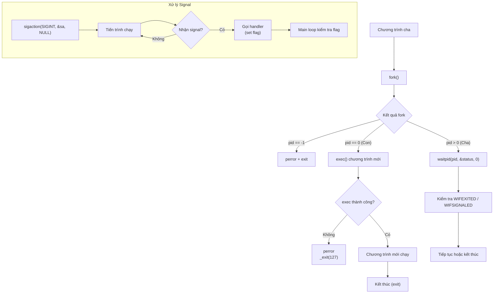

# Lab 6 — Tiến Trình & Tín Hiệu (Processes & Signals)

> [!IMPORTANT]
> **Lệnh biên dịch chuẩn:**
> ```bash
> gcc -Wall -Wextra -std=c11 ex.c -o ex
> ```
> Không cần `-pthread` hay `-D_POSIX_C_SOURCE` cho Lab 6.

---

## 1. `getpid()` / `getppid()` — Lấy PID

```c
#include <unistd.h>

pid_t pid  = getpid();    // PID của tiến trình hiện tại
pid_t ppid = getppid();   // PID của tiến trình cha
printf("PID=%d  PPID=%d\n", pid, ppid);
```

---

## 2. `fork()` — Tạo Tiến Trình Con

```c
#include <unistd.h>

pid_t pid = fork();
if (pid == -1) {          // Lỗi
    perror("fork"); exit(1);
} else if (pid == 0) {    // Tiến trình CON
    printf("Con: PID=%d, cha=%d\n", getpid(), getppid());
    exit(0);
} else {                  // Tiến trình CHA (pid = PID của con)
    printf("Cha: PID=%d, con=%d\n", getpid(), pid);
    wait(NULL);
}
```

> [!NOTE]
> Sau `fork()`: cả cha lẫn con đều có **bản sao** của mọi biến (copy-on-write). Thay đổi biến trong con **không ảnh hưởng** cha.

| Giá trị `fork()` | Ý nghĩa |
|-----------------|---------|
| `-1` | Lỗi, xem `errno` |
| `0` | Đang ở tiến trình **con** |
| `> 0` | Đang ở tiến trình **cha**, giá trị = PID con |

---

## 3. `exit()` / `_exit()` — Kết Thúc Tiến Trình

```c
#include <stdlib.h>   // exit
#include <unistd.h>   // _exit

exit(0);    // Flush stdio buffers → chạy atexit handlers → kết thúc
_exit(0);   // Kết thúc ngay KHÔNG flush buffer
```

> [!CAUTION]
> Trong tiến trình **con** sau `exec` thất bại → dùng `_exit(127)`, **không** dùng `exit()`.
> `exit()` trong con có thể flush buffer của cha (cùng bộ nhớ stdio trước fork) → dữ liệu bị in lặp.

---

## 4. Họ Hàm `exec` — Thay Thế Chương Trình

```c
#include <unistd.h>

execl("/bin/ls", "ls", "-l", NULL);          // Đường dẫn đầy đủ, danh sách args
execv("/bin/ls", args);                       // Đường dẫn đầy đủ, mảng args
execlp("ls", "ls", "-l", NULL);              // Tìm trong PATH, danh sách args
execvp("ls", args);                           // Tìm trong PATH, mảng args
execle("/bin/ls", "ls", NULL, envp);         // Đường dẫn đầy đủ, list + env
```

| Hậu tố | Ý nghĩa |
|--------|---------|
| `l` | Arguments dạng **list** (varargs, kết thúc bằng `NULL`) |
| `v` | Arguments dạng **vector** (mảng `char*`, kết thúc bằng `NULL`) |
| `p` | Tìm chương trình trong **PATH** |
| `e` | Truyền **environment** tùy chỉnh |

```c
// Template chuẩn: fork + exec + waitpid
pid_t pid = fork();
if (pid == 0) {
    execlp("ls", "ls", "-la", NULL);
    perror("exec");   // Chỉ chạy nếu exec thất bại
    _exit(127);
}
int status;
waitpid(pid, &status, 0);
```

> [!NOTE]
> `exec` **thành công** → không bao giờ trả về. Code sau `exec` chỉ chạy khi `exec` thất bại.

---

## 5. `wait()` / `waitpid()` — Chờ Tiến Trình Con

```c
#include <sys/wait.h>

pid_t w = wait(NULL);              // Chờ BẤT KỲ con nào kết thúc
pid_t w = wait(&status);           // Lấy exit status

pid_t w = waitpid(pid, &status, 0);       // Chờ con cụ thể (blocking)
pid_t w = waitpid(-1, &status, 0);        // Chờ bất kỳ con (giống wait)
pid_t w = waitpid(-1, &status, WNOHANG);  // Không chờ (non-blocking)
```

### Macro giải mã `status`:

```c
if (WIFEXITED(status))
    printf("Thoát bình thường, code = %d\n", WEXITSTATUS(status));

if (WIFSIGNALED(status))
    printf("Bị kill bởi signal %d\n", WTERMSIG(status));

if (WIFSTOPPED(status))
    printf("Bị dừng bởi signal %d\n", WSTOPSIG(status));
```

---

## 6. Zombie vs Orphan

| Khái niệm | Giải thích | Quan sát |
|-----------|-----------|---------|
| **Zombie** | Con đã kết thúc nhưng cha chưa `wait()` | `ps aux` → trạng thái `Z` |
| **Orphan** | Cha kết thúc trước con | Con được nhận nuôi bởi `init` (PID 1) |

```bash
# Quan sát zombie
ps aux | grep defunct
# Quan sát tree tiến trình
pstree -p $$
```

> [!NOTE]
> Zombie tồn tại để cha có thể lấy exit status. Nếu cha chết → zombie được `init` dọn.
> Zombie **không dùng CPU** nhưng **chiếm slot** trong bảng tiến trình.

---

## 7. `sigaction()` — Xử Lý Tín Hiệu

```c
#include <signal.h>

// Handler
volatile sig_atomic_t got_signal = 0;
void handler(int sig) {
    got_signal = 1;    // CHỈ set flag, không làm gì khác
}

// Đăng ký handler
struct sigaction sa = {0};
sa.sa_handler = handler;
sigemptyset(&sa.sa_mask);
sa.sa_flags = SA_RESTART;    // Tự restart các syscall bị ngắt
sigaction(SIGINT, &sa, NULL);
```

> [!CAUTION]
> Signal handler chạy trong ngữ cảnh đặc biệt. **Không được** gọi `printf`, `malloc`, `exit` trong handler.
> Chỉ được dùng các hàm **async-signal-safe** (như `write`, `_exit`).

### Các signal thường gặp:

| Signal | Mã số | Nguyên nhân | Mặc định |
|--------|-------|------------|---------|
| `SIGINT` | 2 | Ctrl+C | Kết thúc |
| `SIGTERM` | 15 | `kill pid` | Kết thúc |
| `SIGKILL` | 9 | `kill -9 pid` | Kết thúc (không bắt được) |
| `SIGCHLD` | 17 | Con kết thúc/dừng | Bỏ qua |
| `SIGSTOP` | 19 | Ctrl+Z | Dừng (không bắt được) |
| `SIGALRM` | 14 | `alarm()` hết thời gian | Kết thúc |
| `SIGSEGV` | 11 | Lỗi địa chỉ bộ nhớ | Dump + kết thúc |

---

## 8. Xử Lý SIGCHLD

```c
// Trong handler SIGCHLD — dùng vòng lặp vì nhiều con có thể kết thúc cùng lúc
void sigchld_handler(int sig) {
    (void)sig;
    int status;
    while (waitpid(-1, &status, WNOHANG) > 0)
        ;   // Thu dọn tất cả zombie
}
```

> [!IMPORTANT]
> Luôn dùng **vòng lặp** `waitpid` với `WNOHANG` trong SIGCHLD handler.
> Nhiều con có thể kết thúc trước khi handler chạy → chỉ nhận được 1 signal nhưng có nhiều zombie.

---

## 9. Trạng Thái Tiến Trình (ps)

| Ký hiệu `ps` | Trạng thái | Giải thích |
|-------------|-----------|-----------|
| `R` | Running | Đang chạy hoặc sẵn sàng |
| `S` | Sleeping | Chờ sự kiện (interruptible) |
| `D` | Disk sleep | Chờ I/O (uninterruptible) |
| `T` | Stopped | Bị dừng bởi signal |
| `Z` | Zombie | Kết thúc, chưa được cha `wait()` |

---

## 10. Flow Diagram



---

## 11. Hướng Dẫn Từng Bài

### ex1 — In PID và PPID

```c
printf("PID = %d\n", getpid());
printf("PPID = %d\n", getppid());
```
```bash
gcc -Wall -Wextra -std=c11 ex1.c -o ex1 && ./ex1
```

---

### ex2 — fork(): In thông điệp từ cha và con

```c
pid_t pid = fork();
if (pid == 0) {
    printf("Con: PID=%d\n", getpid());
    exit(0);
} else {
    printf("Cha: PID=%d, con PID=%d\n", getpid(), pid);
    wait(NULL);
}
```

---

### ex3 — Nhiều con với vòng lặp fork

```c
for (int i = 0; i < N; i++) {
    pid_t pid = fork();
    if (pid == 0) {
        printf("Con %d: PID=%d\n", i, getpid());
        exit(0);
    }
}
// Cha chờ tất cả con
for (int i = 0; i < N; i++) wait(NULL);
```

---

### ex4 — fork + exec

```c
pid_t pid = fork();
if (pid == 0) {
    execlp("ls", "ls", "-la", NULL);
    perror("exec"); _exit(127);
}
waitpid(pid, NULL, 0);
```

---

### ex5 — Lấy exit status của con

```c
int status;
waitpid(pid, &status, 0);
if (WIFEXITED(status))
    printf("Con thoát với code %d\n", WEXITSTATUS(status));
```

---

### ex6 — Zombie: Quan sát tiến trình zombie

**Ý tưởng:** Con thoát, cha `sleep()` lâu mà không `wait()` → con trở thành zombie.

```c
pid_t pid = fork();
if (pid == 0) { exit(0); }           // Con thoát ngay
// Cha KHÔNG wait
sleep(30);                            // Zombie tồn tại 30 giây
// Dùng: ps aux | grep defunct
```

---

### ex7 — Orphan: Con trở thành orphan

**Ý tưởng:** Cha thoát, con vẫn đang sleep → con được nhận bởi init.

```c
pid_t pid = fork();
if (pid == 0) {
    sleep(5);
    printf("Con PPID sau khi cha chết: %d\n", getppid());  // Phải là 1
    exit(0);
}
// Cha thoát ngay, không wait
exit(0);
```

---

### ex8 — Bắt SIGINT (Ctrl+C)

```c
volatile sig_atomic_t running = 1;
void handler(int sig) { (void)sig; running = 0; }

struct sigaction sa = {0};
sa.sa_handler = handler;
sigemptyset(&sa.sa_mask);
sigaction(SIGINT, &sa, NULL);

while (running) {
    printf("Đang chạy... (Ctrl+C để dừng)\n");
    sleep(1);
}
printf("Đã nhận SIGINT, thoát.\n");
```

---

### ex9 — `kill()`: Gửi signal đến tiến trình khác

```c
#include <signal.h>
kill(pid, SIGTERM);   // Gửi SIGTERM đến pid
kill(0, SIGTERM);     // Gửi đến tất cả trong cùng process group
```

---

### ex10 — `sigaction` với SIGCHLD

```c
void sigchld_handler(int sig) {
    (void)sig;
    while (waitpid(-1, NULL, WNOHANG) > 0) ;
}
struct sigaction sa = {0};
sa.sa_handler = sigchld_handler;
sa.sa_flags = SA_RESTART | SA_NOCLDSTOP;
sigemptyset(&sa.sa_mask);
sigaction(SIGCHLD, &sa, NULL);
```

---

### ex11 — (BaiKho) Chạy pipeline shell trong C

**Ý tưởng:** Dùng `fork` + `exec` với `/bin/sh -c "ls | wc -l"` hoặc tự dựng pipeline.

```c
execlp("sh", "sh", "-c", "ls | wc -l", NULL);
```

---

### ex12 — (BaiKho) Server-client dùng signal

**Ý tưởng:** Hai tiến trình giao tiếp qua SIGUSR1/SIGUSR2. Dùng PID lấy từ file hoặc truyền qua argv.

---

## 12. Bảng Lỗi Thường Gặp

| Lỗi | Nguyên nhân | Cách sửa |
|-----|------------|---------|
| Zombie tích tụ | Cha không gọi `wait()` | Dùng `wait()` hoặc xử lý SIGCHLD |
| `printf` in 2 lần | Buffer chưa flush trước `fork` | Thêm `fflush(stdout)` trước `fork` |
| Con dùng `exit()` sau exec fail | Flush buffer của cha | Dùng `_exit(127)` |
| `exec` không tìm được file | Sai tên hoặc không trong PATH | Dùng đường dẫn đầy đủ hoặc `execlp` |
| `waitpid` chỉ chờ 1 con | Chỉ gọi 1 lần dù có nhiều con | Dùng vòng lặp `while (wait(NULL) > 0)` |
| Signal handler gọi `printf` | `printf` không async-signal-safe | Dùng `write()` hoặc chỉ set flag |
| SIGCHLD handler bỏ sót zombie | Không dùng vòng lặp | `while (waitpid(-1,NULL,WNOHANG) > 0)` |
| `fork()` trong vòng lặp tạo quá nhiều con | Con cũng fork | `if (pid == 0) { ...; exit(0); }` ngay |
| Không kiểm tra `fork() == -1` | Giới hạn tiến trình hệ thống | Luôn kiểm tra cả 3 nhánh |
| `getppid()` trả về 1 | Cha đã chết (orphan) | Kiểm tra cha còn sống trước |

---

## 13. Bảng Biên Dịch Nhanh

| Bài | Lệnh |
|-----|------|
| ex1 | `gcc -Wall -Wextra -std=c11 ex1.c -o ex1 && ./ex1` |
| ex2 | `gcc -Wall -Wextra -std=c11 ex2.c -o ex2 && ./ex2` |
| ex3 | `gcc -Wall -Wextra -std=c11 ex3.c -o ex3 && ./ex3` |
| ex4 | `gcc -Wall -Wextra -std=c11 ex4.c -o ex4 && ./ex4` |
| ex5 | `gcc -Wall -Wextra -std=c11 ex5.c -o ex5 && ./ex5` |
| ex6 (zombie) | `gcc -Wall -Wextra -std=c11 ex6.c -o ex6 && ./ex6 &` sau đó `ps aux \| grep Z` |
| ex7 (orphan) | `gcc -Wall -Wextra -std=c11 ex7.c -o ex7 && ./ex7` |
| ex8 | `gcc -Wall -Wextra -std=c11 ex8.c -o ex8 && ./ex8` (Ctrl+C để dừng) |
| ex9 | `gcc -Wall -Wextra -std=c11 ex9.c -o ex9 && ./ex9 <pid>` |
| ex10 | `gcc -Wall -Wextra -std=c11 ex10.c -o ex10 && ./ex10` |
| ex11 | `gcc -Wall -Wextra -std=c11 ex11.c -o ex11 && ./ex11` |
| ex12 | `gcc -Wall -Wextra -std=c11 ex12.c -o ex12 && ./ex12` |
