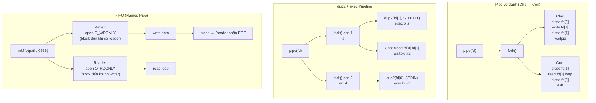

# Lab 7 — Pipe, FIFO & Chuyển Hướng I/O (dup2)

> [!IMPORTANT]
> **Lệnh biên dịch chuẩn:**
> ```bash
> gcc -Wall -Wextra ex.c -o ex
> ```
> Xem thêm [commands.md](./commands.md) để có lệnh biên dịch + chạy cho từng bài.

---

## 1. `pipe()` — Tạo Pipe Vô Danh

```c
#include <unistd.h>

int fd[2];
if (pipe(fd) == -1) { perror("pipe"); exit(1); }
// fd[0] = đầu ĐỌC   (read end)
// fd[1] = đầu GHI   (write end)
```

> [!IMPORTANT]
> `pipe()` phải được gọi **TRƯỚC** `fork()`. Sau fork, cha và con đều có cả 2 đầu.

---

## 2. Pattern Pipe + Fork (Cha → Con)

```c
int fd[2];
pipe(fd);

pid_t pid = fork();
if (pid == 0) {       // === CON: ĐỌC từ fd[0] ===
    close(fd[1]);     // Đóng đầu ghi (không dùng)
    char buf[256]; ssize_t n;
    while ((n = read(fd[0], buf, sizeof(buf))) > 0)
        write(STDOUT_FILENO, buf, n);
    close(fd[0]);
    exit(0);
} else {              // === CHA: GHI vào fd[1] ===
    close(fd[0]);     // Đóng đầu đọc (không dùng)
    write(fd[1], "Hello pipe!\n", 12);
    close(fd[1]);     // QUAN TRỌNG: đóng để con nhận EOF
    waitpid(pid, NULL, 0);
}
```

> [!CAUTION]
> **Cha PHẢI đóng `fd[1]` sau khi ghi xong.** Con chỉ nhận EOF khi **TẤT CẢ** đầu ghi đều bị đóng.
> Nếu cha giữ `fd[1]` mở → `read()` của con sẽ **block mãi mãi**.

---

## 3. Pattern Pipe Hai Chiều (Cha ↔ Con)

```c
int p2c[2], c2p[2];   // parent→child và child→parent
pipe(p2c);
pipe(c2p);

pid_t pid = fork();
if (pid == 0) {
    close(p2c[1]); close(c2p[0]);     // Con: đọc p2c, ghi c2p
    // Đọc từ cha
    char buf[256]; ssize_t n = read(p2c[0], buf, sizeof(buf));
    // Gửi lại cha
    write(c2p[1], "pong\n", 5);
    close(p2c[0]); close(c2p[1]);
    exit(0);
} else {
    close(p2c[0]); close(c2p[1]);     // Cha: ghi p2c, đọc c2p
    write(p2c[1], "ping\n", 5);
    close(p2c[1]);
    char buf[256]; ssize_t n = read(c2p[0], buf, sizeof(buf));
    write(STDOUT_FILENO, buf, n);
    close(c2p[0]);
    waitpid(pid, NULL, 0);
}
```

---

## 4. Vòng Lặp Đọc Hết Pipe (Read-to-EOF)

```c
char buf[4096];
ssize_t n;
while ((n = read(fd[0], buf, sizeof(buf))) > 0) {
    // Xử lý n byte trong buf
    write(STDOUT_FILENO, buf, n);
}
if (n == -1) { perror("read"); }
// n == 0 → EOF (tất cả đầu ghi đã đóng)
```

---

## 5. `dup2()` — Chuyển Hướng File Descriptor

```c
#include <unistd.h>

dup2(oldfd, newfd);   // Sau đó newfd trỏ đến cùng file với oldfd
                       // newfd cũ bị đóng tự động
```

### Chuyển stdout → pipe:

```c
// Trong tiến trình con muốn ghi vào pipe thay vì màn hình
close(fd[0]);                          // Đóng đầu đọc (không cần)
dup2(fd[1], STDOUT_FILENO);           // stdout → đầu ghi pipe
close(fd[1]);                          // Đóng fd[1] gốc (đã dup rồi)
execlp("ls", "ls", "-la", NULL);      // ls sẽ ghi vào pipe
```

### Chuyển stdin → pipe:

```c
// Trong tiến trình con muốn đọc từ pipe thay vì bàn phím
close(fd[1]);
dup2(fd[0], STDIN_FILENO);
close(fd[0]);
execlp("wc", "wc", "-l", NULL);      // wc đọc từ pipe
```

> [!NOTE]
> Thứ tự chuẩn: `close(unused_end)` → `dup2(src, dst)` → `close(src)` → `exec()`

---

## 6. Pipeline `ls | wc -l` — 2 Con + dup2 + exec

```c
int fd[2];
pipe(fd);

// Con 1: chạy ls, stdout → pipe
pid_t pid1 = fork();
if (pid1 == 0) {
    close(fd[0]);
    dup2(fd[1], STDOUT_FILENO);
    close(fd[1]);
    execlp("ls", "ls", NULL);
    _exit(127);
}

// Con 2: chạy wc -l, stdin ← pipe
pid_t pid2 = fork();
if (pid2 == 0) {
    close(fd[1]);
    dup2(fd[0], STDIN_FILENO);
    close(fd[0]);
    execlp("wc", "wc", "-l", NULL);
    _exit(127);
}

// Cha: đóng cả 2 đầu, chờ cả 2 con
close(fd[0]);
close(fd[1]);
waitpid(pid1, NULL, 0);
waitpid(pid2, NULL, 0);
```

> [!CAUTION]
> Cha **bắt buộc** phải đóng cả `fd[0]` và `fd[1]`. Nếu cha giữ `fd[1]` → `wc` không bao giờ nhận EOF.

---

## 7. `dup()` — Nhân Bản File Descriptor

```c
int newfd = dup(oldfd);   // Trả về fd nhỏ nhất chưa dùng, trỏ đến cùng file
// Ít dùng hơn dup2; dup2 cho phép chỉ định fd đích
```

---

## 8. FIFO / Named Pipe — Pipe Có Tên

```c
#include <sys/stat.h>  // mkfifo
#include <fcntl.h>     // O_RDONLY, O_WRONLY

// Tạo FIFO (chỉ cần tạo 1 lần)
if (mkfifo("myfifo", 0666) == -1) {
    if (errno != EEXIST) { perror("mkfifo"); exit(1); }
}

// === BÊN GHI (Writer) ===
int wfd = open("myfifo", O_WRONLY);    // BLOCK đến khi có Reader
write(wfd, "data", 4);
close(wfd);

// === BÊN ĐỌC (Reader) ===
int rfd = open("myfifo", O_RDONLY);    // BLOCK đến khi có Writer
char buf[256]; ssize_t n;
while ((n = read(rfd, buf, sizeof(buf))) > 0)
    write(STDOUT_FILENO, buf, n);
close(rfd);
```

> [!NOTE]
> `open()` FIFO **block** cho đến khi cả reader lẫn writer đều mở. Thứ tự không quan trọng nhưng cả hai phải mở thì mới tiếp tục được.

> [!IMPORTANT]
> FIFO tồn tại trên filesystem (như file thường). Dùng `unlink("myfifo")` để xóa sau khi dùng xong.

| So sánh | Pipe vô danh | FIFO (Named Pipe) |
|---------|-------------|------------------|
| Tạo bởi | `pipe()` | `mkfifo()` |
| Nhìn thấy trong filesystem | Không | Có (như file) |
| Dùng giữa các tiến trình | Chỉ cha-con | Bất kỳ 2 tiến trình |
| Tồn tại sau khi đóng | Không | Có (đến khi `unlink`) |

---

## 9. Flow Diagram



---

## 10. Hướng Dẫn Từng Bài

### ex1 — Tạo pipe, cha ghi, con đọc

**Ý tưởng:** Mẫu cơ bản pipe + fork. Cha ghi 1 chuỗi, con đọc và in ra.

```c
int fd[2]; pipe(fd);
pid_t pid = fork();
if (pid == 0) {
    close(fd[1]);
    char buf[256]; ssize_t n = read(fd[0], buf, sizeof(buf));
    write(STDOUT_FILENO, buf, n);
    close(fd[0]); exit(0);
}
close(fd[0]);
write(fd[1], "Hello from parent!\n", 19);
close(fd[1]);
wait(NULL);
```
```bash
gcc -Wall -Wextra ex1.c -o ex1 && ./ex1
```

---

### ex2 — Con ghi, cha đọc (chiều ngược lại)

```c
// Con ghi vào fd[1], cha đọc từ fd[0]
// Giống ex1 nhưng đảo vai cha/con
```

---

### ex3 — Truyền số nguyên qua pipe

**Ý tưởng:** Ghi `int` trực tiếp bằng `write(fd[1], &num, sizeof(int))`, đọc bằng `read(fd[0], &num, sizeof(int))`.

```c
int x = 42;
write(fd[1], &x, sizeof(int));   // Ghi nhị phân
// ...
int y;
read(fd[0], &y, sizeof(int));    // Đọc nhị phân
printf("Nhận: %d\n", y);
```

---

### ex4 — Pipe hai chiều (cha ↔ con)

**Ý tưởng:** 2 pipe: `p2c` (cha→con) và `c2p` (con→cha). Xem mục 3.

---

### ex5 — Nhiều con đọc từ 1 pipe

> [!NOTE]
> Dữ liệu ghi vào pipe được đọc bởi **1 con** (con nào đọc trước lấy được). Không phải broadcast.

---

### ex6 — `dup2`: Chuyển stdout sang file

```c
int out = open("output.txt", O_WRONLY | O_CREAT | O_TRUNC, 0644);
dup2(out, STDOUT_FILENO);
close(out);
printf("Dòng này vào file!\n");   // Ghi vào file, không phải màn hình
```

---

### ex7 — `dup2`: Chuyển stdin sang file

```c
int in = open("input.txt", O_RDONLY);
dup2(in, STDIN_FILENO);
close(in);
char buf[256];
scanf("%s", buf);    // Đọc từ file thay vì bàn phím
```

---

### ex8 — Bắt output của lệnh vào buffer

**Ý tưởng:** Tạo pipe, fork con chạy lệnh với stdout→pipe, cha đọc từ pipe.

```c
int fd[2]; pipe(fd);
pid_t pid = fork();
if (pid == 0) {
    close(fd[0]);
    dup2(fd[1], STDOUT_FILENO);
    close(fd[1]);
    execlp("date", "date", NULL);
    _exit(127);
}
close(fd[1]);
char buf[256]; ssize_t n = read(fd[0], buf, sizeof(buf) - 1);
buf[n] = '\0';
printf("Output của date: %s", buf);
close(fd[0]);
waitpid(pid, NULL, 0);
```

---

### ex9 — Pipeline `ls | wc -l`

**Ý tưởng:** 2 con + dup2 + exec. Xem mục 6 (Pipeline đầy đủ).

```bash
gcc -Wall -Wextra ex9.c -o ex9 && ./ex9
```

---

### ex10 — FIFO: Writer và Reader (1 chương trình, 2 tiến trình)

**Ý tưởng:** Fork → con là writer, cha là reader (hoặc ngược lại). Dùng FIFO thay pipe.

```c
mkfifo("myfifo", 0666);
pid_t pid = fork();
if (pid == 0) {
    // Con: writer
    int wfd = open("myfifo", O_WRONLY);
    write(wfd, "Hello FIFO\n", 11);
    close(wfd);
    exit(0);
}
// Cha: reader
int rfd = open("myfifo", O_RDONLY);
char buf[256]; ssize_t n = read(rfd, buf, sizeof(buf));
write(STDOUT_FILENO, buf, n);
close(rfd);
unlink("myfifo");
waitpid(pid, NULL, 0);
```

---

### ex11 — FIFO: 2 chương trình độc lập (writer.c + reader.c)

**writer.c:**
```c
// mkfifo nếu chưa có, open O_WRONLY, write, close
```

**reader.c:**
```c
// mkfifo nếu chưa có, open O_RDONLY, read loop, close, unlink
```

```bash
# Chạy trong 2 terminal
gcc writer.c -o writer && ./writer &
gcc reader.c -o reader && ./reader
```

---

### ex12 — FIFO: Chat 2 chiều (2 FIFO)

**Ý tưởng:** `fifo1` (A→B), `fifo2` (B→A). Mỗi chương trình vừa đọc vừa ghi luân phiên.

```c
// Chương trình A:
int wfd = open("fifo1", O_WRONLY);
int rfd = open("fifo2", O_RDONLY);
// Ghi câu hỏi → đọc câu trả lời
```

---

## 11. Bảng Lỗi Thường Gặp

| Lỗi | Nguyên nhân | Cách sửa |
|-----|------------|---------|
| `read()` block mãi mãi | Cha chưa đóng `fd[1]` | Gọi `close(fd[1])` sau khi ghi xong |
| EOF không đến | Còn fd ghi mở ở đâu đó | Đóng **tất cả** bản sao của đầu ghi |
| `open(FIFO)` block mãi | Chưa có phía kia mở | Mở reader và writer **đồng thời** (2 terminal hoặc fork) |
| `mkfifo` lỗi lần 2 | FIFO đã tồn tại | Kiểm tra `errno != EEXIST` |
| Pipeline bị deadlock | Cha không đóng fd | Cha luôn đóng cả `fd[0]` lẫn `fd[1]` |
| `printf` sau `dup2` không thấy | Buffer chưa flush | Thêm `fflush(stdout)` trước `dup2` |
| Không dùng `_exit` sau exec fail | Flush buffer cha | Dùng `_exit(127)` |
| Quên `close(fd[x])` sau `dup2` | Fd leak | `close(fd[x])` ngay sau `dup2` |
| FIFO vẫn còn trên disk | Không gọi `unlink` | `unlink("myfifo")` sau khi dùng xong |
| `dup2` sai thứ tự args | `dup2(new, old)` nhầm hướng | `dup2(src, dst)` — src là nguồn, dst là đích |

---

## 12. Bảng Biên Dịch Nhanh

| Bài | Lệnh |
|-----|------|
| ex1 | `gcc -Wall -Wextra ex1.c -o ex1 && ./ex1` |
| ex2 | `gcc -Wall -Wextra ex2.c -o ex2 && ./ex2` |
| ex3 | `gcc -Wall -Wextra ex3.c -o ex3 && ./ex3` |
| ex4 | `gcc -Wall -Wextra ex4.c -o ex4 && ./ex4` |
| ex5 | `gcc -Wall -Wextra ex5.c -o ex5 && ./ex5` |
| ex6 | `gcc -Wall -Wextra ex6.c -o ex6 && ./ex6` |
| ex7 | `gcc -Wall -Wextra ex7.c -o ex7 && ./ex7` |
| ex8 | `gcc -Wall -Wextra ex8.c -o ex8 && ./ex8` |
| ex9 | `gcc -Wall -Wextra ex9.c -o ex9 && ./ex9` |
| ex10 | `gcc -Wall -Wextra ex10.c -o ex10 && ./ex10` |
| ex11 writer | `gcc -Wall -Wextra writer.c -o writer && ./writer` |
| ex11 reader | `gcc -Wall -Wextra reader.c -o reader && ./reader` |
| ex12 A | `gcc -Wall -Wextra ex12a.c -o ex12a && ./ex12a` |
| ex12 B | `gcc -Wall -Wextra ex12b.c -o ex12b && ./ex12b` |
