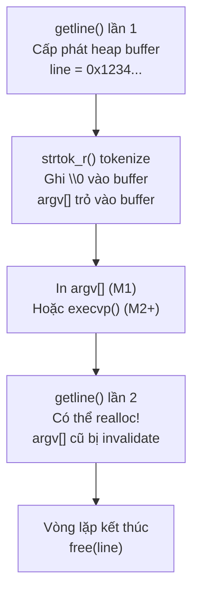
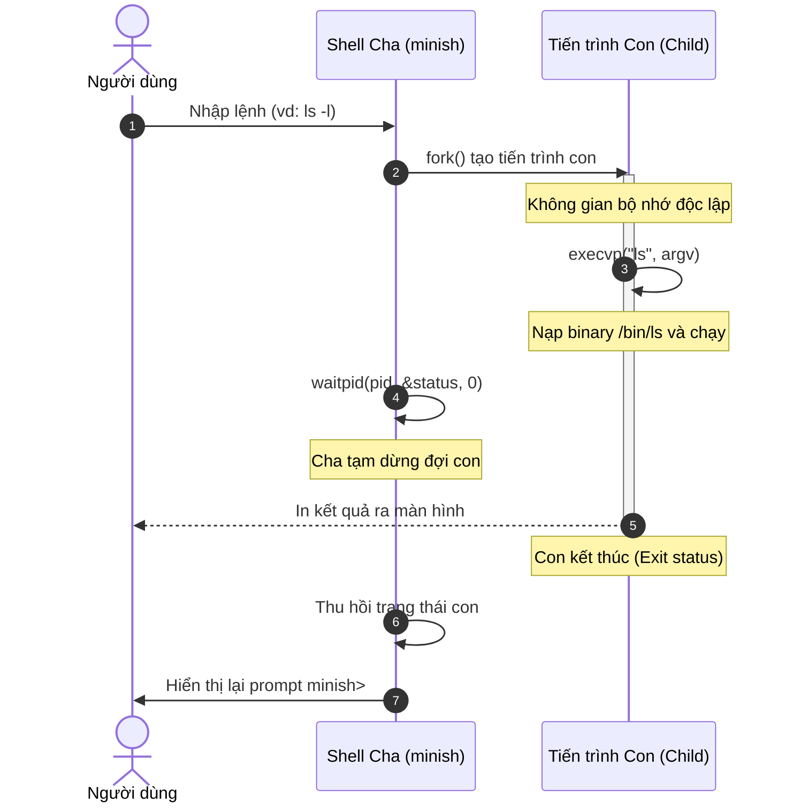
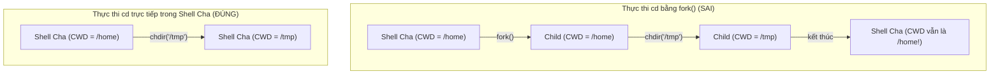
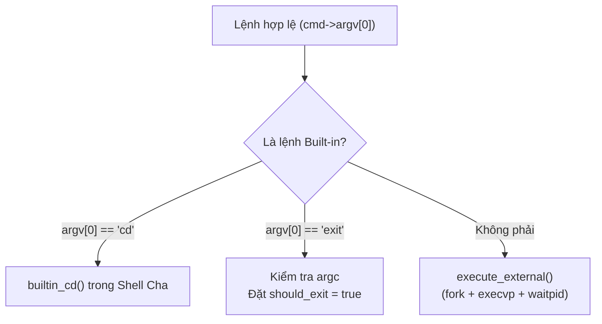
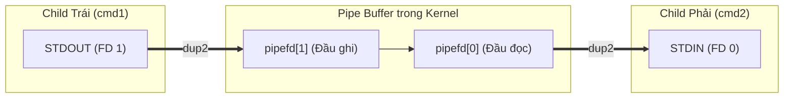
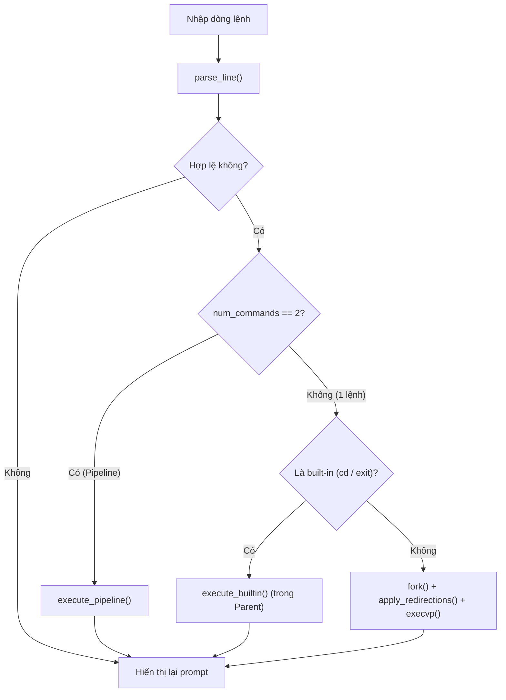

# 🧠 Milestone 1 – Kiến thức cần có

> **Phạm vi M1:** Đọc dòng lệnh → tokenize → xây dựng `argv[]` → in kết quả. Chưa thực thi lệnh.

---

## 1. Con trỏ và chuỗi trong C

### Tại sao cần?
`argv` là mảng các **con trỏ** trỏ vào **cùng một buffer** mà `getline()` cấp phát. Hiểu sai điều này sẽ gây lỗi use-after-free hoặc dữ liệu bị ghi đè.

### Kiến thức cần nắm

| Khái niệm | Giải thích |
|---|---|
| `char *p` | Con trỏ tới ký tự đầu tiên của chuỗi |
| `char **argv` | Mảng con trỏ chuỗi (double pointer) |
| `argv[argc] = NULL` | Terminator bắt buộc cho `execvp()` |
| Buffer lifetime | Buffer sống đến khi `free(line)` hoặc `getline()` tái cấp phát |

### Minh họa bộ nhớ

```
Buffer (heap):  "ls\0-l\0/tmp\0"
                 ↑     ↑     ↑
argv[0]─────────┘     │     │
argv[1]───────────────┘     │
argv[2]─────────────────────┘
argv[3] = NULL
```

> [!WARNING]
> `strtok_r()` **ghi đè** ký tự phân cách bằng `\0` trực tiếp vào buffer. `argv[i]` chỉ là pointer vào buffer đó — không phải bản sao.

---

## 2. `getline()` – Đọc dòng lệnh

### Prototype

```c
#include <stdio.h>

ssize_t getline(char **lineptr, size_t *n, FILE *stream);
```

### Tham số

| Tham số | Ý nghĩa |
|---|---|
| `lineptr` | Địa chỉ của con trỏ buffer. `getline()` tự realloc nếu cần. |
| `n` | Địa chỉ của kích thước buffer hiện tại |
| `stream` | Luồng đọc (dùng `stdin`) |
| **Trả về** | Số byte đọc được (kể cả `\n`), hoặc `-1` nếu EOF/lỗi |

### Mẫu sử dụng đúng

```c
char   *line     = NULL;  /* getline() tự cấp phát */
size_t  capacity = 0;     /* getline() tự điều chỉnh */

fputs("minish> ", stdout);
fflush(stdout);           /* phải flush trước khi block đọc */

ssize_t len = getline(&line, &capacity, stdin);

if (len == -1) {
    /* EOF (Ctrl+D) hoặc lỗi */
    free(line);
    break; /* thoát vòng lặp */
}
/* line chứa "\n" ở cuối — strtok_r sẽ bỏ nó */
```

### Các điểm dễ nhầm

| Lỗi thường gặp | Cách đúng |
|---|---|
| Khởi tạo `line = ""` | Phải là `line = NULL` |
| Bỏ qua `fflush(stdout)` | Prompt không hiện trước khi nhập |
| Không `free(line)` | Memory leak sau khi thoát |
| Check `len == 0` cho EOF | Phải check `len == -1` |

---

## 3. `strtok_r()` – Tokenize (thread-safe)

### Prototype

```c
#include <string.h>

char *strtok_r(char *str, const char *delim, char **saveptr);
```

### Cách hoạt động

1. Lần gọi đầu: `str` = con trỏ buffer, `saveptr` lưu vị trí.
2. Các lần gọi tiếp: `str = NULL`, hàm tiếp tục từ `saveptr`.
3. Trả về `NULL` khi hết token.
4. **Ghi `\0`** vào vị trí phân cách — buffer bị sửa.

### Mẫu tokenize hoàn chỉnh

```c
static int parse_command(char *line, Command *cmd) {
    memset(cmd, 0, sizeof(*cmd));
    char *saveptr = NULL;

    for (char *tok = strtok_r(line, " \t\r\n", &saveptr);
         tok != NULL;
         tok = strtok_r(NULL, " \t\r\n", &saveptr))
    {
        if (cmd->argc >= MAX_ARGS) {
            fprintf(stderr, "minish: too many arguments\n");
            return -1;
        }
        cmd->argv[cmd->argc++] = tok;
        cmd->argv[cmd->argc]   = NULL; /* luôn cập nhật terminator */
    }

    return (cmd->argc > 0) ? 1 : 0;
    /*     1 = có lệnh      0 = dòng trống   -1 = lỗi */
}
```

### Tại sao dùng `strtok_r` chứ không phải `strtok`?

`strtok()` dùng biến static nội bộ → không an toàn khi gọi lồng nhau.  
`strtok_r()` dùng `saveptr` do caller cung cấp → an toàn.

---

## 4. Struct `Command` và `argv[]`

### Định nghĩa

```c
#define MAX_ARGS  32
#define MAX_LINE  4096

typedef struct {
    char *argv[MAX_ARGS + 1]; /* +1 cho NULL terminator */
    int   argc;               /* số lượng argument */
} Command;
```

### Quy tắc bất biến

```
argv[argc] == NULL         ← luôn đúng
argv[0]    == tên lệnh     ← "ls", "echo", ...
argc       >= 1            ← nếu có lệnh hợp lệ
```

### Kiểm tra sau tokenize

```c
Command cmd;
int result = parse_command(line, &cmd);
if (result == 1) {
    printf("argc = %d\n", cmd.argc);
    for (int i = 0; i < cmd.argc; i++)
        printf("argv[%d] = \"%s\"\n", i, cmd.argv[i]);
}
```

---

## 5. Vòng lặp chính (REPL)

### Cấu trúc tổng thể M1

```c
int main(void) {
    char   *line     = NULL;
    size_t  capacity = 0;

    while (1) {
        /* 1. Hiển thị prompt */
        fputs("minish> ", stdout);
        fflush(stdout);

        /* 2. Đọc lệnh */
        ssize_t len = getline(&line, &capacity, stdin);
        if (len == -1) break; /* EOF */

        /* 3. Kiểm tra độ dài */
        if (len > MAX_LINE) {
            fprintf(stderr, "minish: line too long\n");
            continue;
        }

        /* 4. Tokenize */
        Command cmd;
        int result = parse_command(line, &cmd);

        if (result == 0)  continue; /* dòng trống */
        if (result == -1) continue; /* lỗi parse */

        /* 5. In kết quả (M1 chưa thực thi) */
        printf("argc=%d\n", cmd.argc);
        for (int i = 0; i < cmd.argc; i++)
            printf("  argv[%d]=\"%s\"\n", i, cmd.argv[i]);
    }

    /* 6. Cleanup */
    free(line);
    return 0;
}
```

---

## 6. Xử lý lỗi và edge cases

### Bảng kiểm tra M1

| Input | Hành vi mong đợi |
|---|---|
| `ls -l /tmp` | argc=3, argv[0]="ls", argv[1]="-l", argv[2]="/tmp" |
| `   echo   hello  ` | argc=2 (khoảng trắng thừa bị bỏ) |
| *(dòng trống)* | Không in gì, hiện prompt tiếp |
| Ctrl+D | Thoát sạch |
| 33 arguments | Báo lỗi "too many arguments", bỏ qua lệnh |
| Dòng > 4096 byte | Báo lỗi "line too long", bỏ qua |

### Giá trị trả về của `parse_command()`

```
 1  → lệnh hợp lệ, có ít nhất 1 token
 0  → dòng trống / chỉ có whitespace
-1  → lỗi (quá nhiều argument, v.v.)
```

---

## 7. Quản lý bộ nhớ

### Vòng đời của buffer



> [!CAUTION]
> Sau khi `getline()` được gọi lần tiếp theo, các con trỏ trong `argv[]` từ lần trước có thể bị invalidate nếu buffer bị realloc. Luôn parse lại sau mỗi lần đọc.

---

## 8. Compile và test M1

```bash
# Biên dịch với cảnh báo đầy đủ
gcc -Wall -Wextra -o minish_m1 minish_m1.c

# Chạy thử
./minish_m1

# Kiểm tra leak (Linux)
valgrind --leak-check=full ./minish_m1
```

### Checklist hoàn thành M1

- [ ] `fputs` + `fflush` hiển thị prompt
- [ ] `getline(&line, &capacity, stdin)` đọc đúng
- [ ] `parse_command()` tokenize với `strtok_r()`
- [ ] `argv[argc] == NULL` luôn đúng
- [ ] Dòng trống → `continue`
- [ ] EOF → `break` → `free(line)` → `return 0`
- [ ] > 32 args → báo lỗi, `continue`
- [ ] > 4096 byte → báo lỗi, `continue`
- [ ] Biên dịch sạch với `-Wall -Wextra`

---

## Bổ sung: Header cần include

```c
#include <stdio.h>    /* fputs, fflush, getline, fprintf, printf, perror */
#include <stdlib.h>   /* free, getenv */
#include <string.h>   /* strtok_r, memset, strlen */
#include <stdbool.h>  /* bool (dùng từ M3) */
/* M2+ */
#include <unistd.h>   /* fork, execvp, chdir, _exit, dup2, close, pipe */
#include <sys/types.h>/* pid_t */
#include <sys/wait.h> /* waitpid */
#include <fcntl.h>    /* open, O_RDONLY, O_WRONLY, O_CREAT, O_TRUNC */
#include <errno.h>    /* errno, EINTR */
```


---

# 🚀 Milestone 2 – Thực thi lệnh ngoài (External Commands)

> **Phạm vi M2:** Kế thừa parser của M1 → dùng `fork()`, `execvp()`, `waitpid()` để thực thi các lệnh ngoài (`ls`, `pwd`, `echo`,...) trong tiến trình con (child process). Shell cha (parent) phải tiếp tục sống, thu hồi child đúng cách và không bao giờ bị crash khi lệnh con gặp lỗi.

---

## 1. Mô hình thực thi tiến trình: fork – exec – wait

### Tại sao cần `fork()` trước khi `execvp()`?

Khi gọi hàm thuộc họ `exec` (như `execvp`), hệ điều hành sẽ **thay thế toàn bộ image bộ nhớ** (mã lệnh, dữ liệu, heap, stack) của tiến trình hiện tại bằng chương trình mới.

> [!CAUTION]
> Nếu bạn gọi trực tiếp `execvp()` trong tiến trình shell cha:
> - Chương trình mới (`ls`, `echo`,...) sẽ đè lên shell.
> - Khi chương trình đó chạy xong, tiến trình kết thúc → **mini-shell bị thoát ngay lập tức!**
> - Vì vậy, shell cha **bắt buộc** phải tạo tiến trình con (`fork()`) để con nạp lệnh mới, còn cha tiếp tục đứng đợi và nhận lệnh tiếp theo.

### Sơ đồ tiến trình M2



---

## 2. `fork()` – Tạo tiến trình con

### Prototype

```c
#include <unistd.h>
#include <sys/types.h>

pid_t fork(void);
```

### Giá trị trả về

| Giá trị trả về | Ý nghĩa |
|---|---|
| `< 0` (`-1`) | `fork()` thất bại (hết PID hoặc cạn bộ nhớ hệ thống). Dùng `perror("fork")`. |
| `== 0` | Đang ở **tiến trình con** (Child). |
| `> 0` | Đang ở **tiến trình cha** (Parent). Giá trị trả về chính là **PID của con**. |

### Mẫu kiểm tra chuẩn

```c
pid_t pid = fork();

if (pid < 0) {
    perror("minish: fork");
    /* Cha tiếp tục vòng lặp, không thoát shell */
} else if (pid == 0) {
    /* ĐÂY LÀ TIẾN TRÌNH CON */
    /* Thực hiện execvp() tại đây */
} else {
    /* ĐÂY LÀ TIẾN TRÌNH CHA */
    /* Chờ tiến trình con hoàn thành tại đây */
}
```

---

## 3. `execvp()` và `_exit()` – Nạp lệnh và kết thúc an toàn

### Prototype `execvp()`

```c
#include <unistd.h>

int execvp(const char *file, char *const argv[]);
```

- `file`: Tên chương trình (vd `"ls"`) hoặc đường dẫn (vd `"/bin/ls"`). Nếu không chứa `/`, hệ điều hành sẽ tự động tìm kiếm trong các thư mục liệt kê tại biến môi trường `$PATH`.
- `argv`: Mảng các con trỏ chuỗi, kết thúc bằng con trỏ `NULL` (đã đảm bảo từ M1: `argv[argc] = NULL`).
- **Giá trị trả về:**
  - Nếu thành công: **Hàm không bao giờ trả về** (vì mã shell con đã bị thay thế hoàn toàn).
  - Nếu thất bại: Trả về `-1`, thiết lập `errno`.

### Tại sao phải dùng `_exit()` mà không dùng `exit()` khi `execvp()` thất bại?

| Hàm | Đặc điểm | Khi nào dùng? |
|---|---|---|
| `exit(code)` | Flush stdio buffer, gọi các hàm dọn dẹp đã đăng ký qua `atexit()`. | Dùng trong tiến trình cha khi thoát hẳn shell. |
| `_exit(code)` | Thoát ngay lập tức ở mức kernel syscall, không đụng chạm stdio buffer của cha. | **Bắt buộc dùng trong tiến trình con sau khi `fork()`** nếu `execvp()` thất bại. |

> [!WARNING]
> Nếu trong tiến trình con bạn gọi `exit()` thông thường, nó có thể làm flush hoặc đóng các stream bộ đệm I/O dùng chung của tiến trình cha, gây lỗi hiển thị hoặc mất dữ liệu trên shell cha! Luôn dùng `_exit(127)` hoặc `_exit(1)`.

```c
/* Trong tiến trình con: */
execvp(cmd->argv[0], cmd->argv);

/* Nếu dòng này được chạm tới -> execvp ĐÃ THẤT BẠI! */
perror("minish: execvp");
_exit(127); /* 127 là mã POSIX chuẩn cho "command not found" */
```

---

## 4. `waitpid()` – Chờ và thu hồi tiến trình con

### Prototype

```c
#include <sys/wait.h>

pid_t waitpid(pid_t pid, int *status, int options);
```

### Tham số

| Tham số | Giá trị trong M2 | Giải thích |
|---|---|---|
| `pid` | `pid` (con vừa tạo) | Chờ đúng tiến trình con cụ thể vừa fork. |
| `status` | `&status` | Địa chỉ biến `int` nhận trạng thái kết thúc. |
| `options` | `0` | Chế độ blocking (dừng cha lại đợi con kết thúc). |

### Xử lý lỗi ngắt tín hiệu (`EINTR`)

Trong môi trường Unix, lời gọi hàm `waitpid()` có thể bị ngắt bởi tín hiệu (signal). Khi đó, `waitpid()` trả về `-1` và gán `errno = EINTR`.

> [!IMPORTANT]
> Đây không phải lỗi nghiêm trọng của chương trình. Shell cha **phải tự động gọi lại** `waitpid()` để tiếp tục chờ child, tránh để child trở thành tiến trình ma (Zombie process).

```c
int status;
pid_t res;

do {
    res = waitpid(pid, &status, 0);
} while (res == -1 && errno == EINTR);
```

### Các macro kiểm tra trạng thái thoát (Tham khảo mở rộng)

- `WIFEXITED(status)`: Trả về true nếu child kết thúc bình thường (qua `return` hoặc `exit`).
- `WEXITSTATUS(status)`: Lấy mã thoát (`exit code`, vd: 0, 1, 127).
- `WIFSIGNALED(status)`: Trả về true nếu child bị terminate bởi signal (vd: SIGINT, SIGSEGV).
- `WTERMSIG(status)`: Lấy mã tín hiệu đã kết thúc child.

---

## 5. Tổ chức mã nguồn `execute_external()`

```c
/* Thực thi lệnh ngoài trong tiến trình con */
static int execute_external(const Command *cmd) {
    pid_t pid = fork();

    if (pid < 0) {
        perror("minish: fork");
        return -1;
    }

    if (pid == 0) {
        /* Tiến trình con */
        execvp(cmd->argv[0], cmd->argv);
        /* Đến được đây tức là execvp thất bại */
        perror("minish: execvp");
        _exit(127);
    }

    /* Tiến trình cha: Chờ tiến trình con kết thúc */
    int status;
    pid_t res;
    do {
        res = waitpid(pid, &status, 0);
    } while (res == -1 && errno == EINTR);

    return 0;
}
```

### Cập nhật vòng lặp chính trong `minish_m2.c`

Thay vì in kết quả `argc` và `argv` như M1, ta gọi `execute_external(&cmd)`:

```c
/* ... Sau khi parse_command thành công (result == 1) ... */
execute_external(&cmd);
```

---

## 6. Bảng kiểm tra và Edge cases M2

| Lệnh test | Kết quả mong đợi | Ý nghĩa kiểm tra |
|---|---|---|
| `echo hello` | In `hello` | Chạy lệnh ngoài cơ bản |
| `pwd` | In đường dẫn thư mục hiện tại | Lệnh không tham số |
| `ls -l /tmp` | In danh sách tệp của `/tmp` | Lệnh có nhiều tham số |
| `not_a_real_cmd` | In `minish: execvp: No such file or directory`<br>và **shell tiếp tục nhận lệnh** | Lỗi thực thi không làm crash shell cha |
| `echo recovered` | In `recovered` | Đảm bảo shell tiếp tục chạy tốt sau khi gặp lệnh lỗi |
| `sleep 2` | Shell dừng 2 giây rồi mới hiện prompt | `waitpid()` blocking chính xác |

---

## 7. Checklist hoàn thành M2

- [ ] Giữ nguyên parser và vòng lặp nhập của M1.
- [ ] Dùng `fork()` tạo tiến trình con.
- [ ] Kiểm tra lỗi `pid < 0`, báo lỗi bằng `perror()`.
- [ ] Trong child (`pid == 0`): gọi `execvp(cmd->argv[0], cmd->argv)`.
- [ ] Nếu `execvp` thất bại: gọi `perror()` và **kết thúc child bằng `_exit(127)`**.
- [ ] Trong parent (`pid > 0`): gọi `waitpid()` chờ đúng PID của child.
- [ ] Lặp lại `waitpid()` nếu bị ngắt với `errno == EINTR`.
- [ ] Lệnh sai không làm crash hoặc thoát shell cha.
- [ ] Biên dịch sạch với `gcc -Wall -Wextra -o minish_m2 minish_m2.c`.

---

# ⚙️ Milestone 3 – Xử lý lệnh tích hợp (Built-in Commands: cd & exit)

> **Phạm vi M3:** Bổ sung bộ điều phối (dispatcher) phân biệt lệnh nội bộ (built-in) và lệnh ngoài. Xử lý hai lệnh nội bộ thay đổi trực tiếp trạng thái của tiến trình shell cha: `cd` và `exit`. Các lệnh ngoài vẫn được ủy quyền cho `execute_external()`.

---

## 1. Tại sao `cd` và `exit` bắt buộc phải là Built-in?

### Vấn đề không gian địa chỉ tiến trình

Mỗi tiến trình trong hệ điều hành Unix có một không gian trạng thái riêng biệt:
- **Thư mục làm việc hiện tại (Current Working Directory - CWD)**
- **Vòng đời tiến trình (Process Lifecycle)**



> [!IMPORTANT]
> - Nếu chạy `cd` trong tiến trình con (child): chỉ có thư mục của child bị đổi. Khi child kết thúc, shell cha vẫn đứng ở thư mục cũ!
> - Nếu chạy `exit` trong tiến trình con: chỉ có child kết thúc, shell cha vẫn tiếp tục chạy!
> - **Kết luận:** Mọi lệnh thay đổi trạng thái của shell (`cd`, `exit`, `export`,...) **bắt buộc phải chạy trực tiếp trong tiến trình shell cha**.

---

## 2. Lệnh `cd` và hàm `chdir()`

### Prototype

```c
#include <unistd.h>
#include <stdlib.h>

int chdir(const char *path);
char *getenv(const char *name);
```

### Xử lý 3 trường hợp của lệnh `cd`

1. **`cd` không có đối số (`cmd->argc == 1`):**
   - Chuyển về thư mục người dùng qua biến môi trường `$HOME`.
   - Lấy giá trị: `const char *home = getenv("HOME");`
   - Nếu `home == NULL`: báo lỗi `"minish: cd: HOME not set\n"`.
   - Ngược lại: gọi `chdir(home)`.
2. **`cd path` có 1 đối số (`cmd->argc == 2`):**
   - Gọi trực tiếp `chdir(cmd->argv[1])`.
   - Nếu `chdir` trả về `-1`: báo lỗi bằng `perror("minish: cd")`.
3. **`cd` có nhiều hơn 1 đối số (`cmd->argc > 2`):**
   - Theo chuẩn đề bài: Báo lỗi cú pháp, **không** gọi `chdir()`.
   - In thông báo: `fprintf(stderr, "minish: cd: too many arguments\n");`

### Cài đặt hàm `builtin_cd()`

```c
static int builtin_cd(const Command *cmd) {
    if (cmd->argc > 2) {
        fprintf(stderr, "minish: cd: too many arguments\n");
        return -1;
    }

    const char *target = NULL;
    if (cmd->argc == 1) {
        target = getenv("HOME");
        if (target == NULL) {
            fprintf(stderr, "minish: cd: HOME not set\n");
            return -1;
        }
    } else {
        target = cmd->argv[1];
    }

    if (chdir(target) != 0) {
        perror("minish: cd");
        return -1;
    }

    return 0;
}
```

---

## 3. Lệnh `exit` và cơ chế Graceful Shutdown

### Yêu cầu đề bài

- `exit` chỉ chấp nhận khi **không có đối số** (`cmd->argc == 1`).
- Nếu có đối số (vd `exit 1`): Báo lỗi `minish: exit: too many arguments` và **không thoát shell**.
- Khi thoát hợp lệ: Đặt cờ kết thúc để vòng lặp chính dọn dẹp bộ nhớ (cleanup) an toàn.

> [!TIP]
> Không nên gọi hàm `exit(0)` trực tiếp bên trong dispatcher vì sẽ làm mất cơ hội `free(line)` ở cuối `main()`. Hãy dùng một biến cờ:
> ```c
> bool should_exit = false;
> ```
> Khi gặp lệnh `exit`, dispatcher gán `*should_exit = true;`. Vòng lặp `main` sẽ tự kiểm tra cờ này để `break`, sau đó thực hiện giải phóng tài nguyên.

---

## 4. Thiết kế Bộ điều phối lệnh (Dispatcher)

### Kiến trúc điều phối



### Triển khai `execute_builtin()` và `dispatch_command()`

```c
#include <stdbool.h>

/* Thực thi lệnh tích hợp (nếu có). Trả về 1 nếu là built-in, 0 nếu không phải */
static int execute_builtin(const Command *cmd, bool *should_exit) {
    if (strcmp(cmd->argv[0], "cd") == 0) {
        builtin_cd(cmd);
        return 1;
    }

    if (strcmp(cmd->argv[0], "exit") == 0) {
        if (cmd->argc > 1) {
            fprintf(stderr, "minish: exit: too many arguments\n");
        } else {
            *should_exit = true;
        }
        return 1;
    }

    return 0; /* Không phải built-in */
}

/* Bộ điều phối trung tâm */
static int dispatch_command(const Command *cmd, bool *should_exit) {
    if (execute_builtin(cmd, should_exit)) {
        return 0;
    }
    return execute_external(cmd);
}
```

### Vòng lặp `main()` trong `minish_m3.c`

```c
int main(void) {
    char   *line        = NULL;
    size_t  capacity    = 0;
    bool    should_exit = false;

    while (!should_exit) {
        fputs("minish> ", stdout);
        fflush(stdout);

        ssize_t len = getline(&line, &capacity, stdin);
        if (len == -1) break; /* EOF (Ctrl+D) */

        if (len > MAX_LINE) {
            fprintf(stderr, "minish: line too long\n");
            continue;
        }

        Command cmd;
        int result = parse_command(line, &cmd);
        if (result <= 0) continue; /* Bỏ qua dòng trống hoặc lỗi parse */

        /* Điều phối lệnh */
        dispatch_command(&cmd, &should_exit);
    }

    /* Cleanup giải phóng bộ nhớ */
    free(line);
    return 0;
}
```

---

## 5. Bảng kiểm tra và Edge cases M3

| Kịch bản kiểm thử | Lệnh gõ vào `minish>` | Kết quả mong đợi |
|---|---|---|
| Kiểm tra thư mục ban đầu | `pwd` | In thư mục hiện tại |
| Đổi thư mục hợp lệ | `cd /tmp`<br>`pwd` | In `/tmp` (Thư mục cha đã thực sự thay đổi!) |
| Đổi thư mục về HOME | `cd`<br>`pwd` | In thư mục Home (vd `/home/student`) |
| Thư mục không tồn tại | `cd /invalid/path` | Báo lỗi `minish: cd: No such file or directory`, shell tiếp tục |
| `cd` quá nhiều đối số | `cd a b c` | Báo lỗi `minish: cd: too many arguments`, thư mục không đổi |
| Lệnh ngoài vẫn chạy | `echo test` | In `test` |
| `exit` kèm đối số | `exit 1 2` | Báo lỗi `minish: exit: too many arguments`, shell KHÔNG thoát |
| `exit` hợp lệ | `exit` | Shell kết thúc êm đẹp, trả về exit code 0 |

---

## 6. Checklist hoàn thành M3

- [ ] Thêm header `<stdbool.h>`.
- [ ] Lệnh `cd` được xử lý trong tiến trình cha bằng `chdir()`.
- [ ] `cd` không đối số chuyển về thư mục `getenv("HOME")`.
- [ ] `cd` quá 1 đối số báo lỗi `too many arguments`.
- [ ] Lỗi `chdir()` được báo qua `perror()`, shell không chết.
- [ ] Lệnh `exit` kiểm tra không cho phép đối số thừa.
- [ ] Thoát shell qua cờ `should_exit` và `free(line)` trước khi `return 0`.
- [ ] Dispatcher định tuyến chính xác giữa built-in và external.
- [ ] Biên dịch sạch với `gcc -Wall -Wextra -o minish_m3 minish_m3.c`.

---

# 🔀 Milestone 4 – Chuyển hướng I/O & Pipeline (Redirection & Pipes)

> **Phạm vi M4 (Hoàn thiện `minish.c`):**
> 1. Mở rộng parser nhận biết `<` (input), `>` (output), và `|` (pipeline tối đa 2 lệnh).
> 2. Sử dụng `open()` và `dup2()` để chuyển hướng stdin/stdout trong child process.
> 3. Sử dụng `pipe()` kết nối đầu ra lệnh 1 với đầu vào lệnh 2.
> 4. Hỗ trợ kết hợp: `cat < in.txt | wc -l > out.txt`.

---

## 1. Bảng mô tả tệp (File Descriptors) & Chuyển hướng I/O

Mỗi tiến trình khi khởi chạy mặc định có 3 file descriptor (FD):

| FD | Hằng số POSIX | Tên luồng | Mặc định trỏ tới |
|---|---|---|---|
| `0` | `STDIN_FILENO` | Standard Input (Đầu vào chuẩn) | Bàn phím |
| `1` | `STDOUT_FILENO` | Standard Output (Đầu ra chuẩn) | Màn hình terminal |
| `2` | `STDERR_FILENO` | Standard Error (Đầu ra lỗi chuẩn) | Màn hình terminal |

### Bản chất của chuyển hướng (Redirection)

Chương trình bên ngoài (như `cat`, `grep`, `wc`) chỉ đơn thuần đọc từ FD 0 và ghi ra FD 1. Chúng **không hề biết** dữ liệu đến từ bàn phím, file hay pipe.

Chính tiến trình shell con (trước khi gọi `execvp`) sẽ tráo đổi đối tượng mà FD 0 hoặc FD 1 trỏ tới bằng cách dùng `open()` và `dup2()`.

---

## 2. `open()` và `dup2()` – Thực hiện chuyển hướng

### Chuyển hướng đầu vào: `<`

Mở tệp chỉ đọc `O_RDONLY`, sau đó nối vào `STDIN_FILENO` (FD 0):

```c
int fd = open(cmd->input_file, O_RDONLY);
if (fd < 0) {
    perror("minish: open input");
    _exit(1);
}
if (dup2(fd, STDIN_FILENO) == -1) {
    perror("minish: dup2 input");
    close(fd);
    _exit(1);
}
close(fd); /* Đóng fd gốc sau khi đã dup2 */
```

### Chuyển hướng đầu ra: `>`

Mở tệp ghi `O_WRONLY | O_CREAT | O_TRUNC` (nếu chưa có thì tạo mới, nếu có rồi thì ghi đè từ đầu) với quyền `0644` (`rw-r--r--`), nối vào `STDOUT_FILENO` (FD 1):

```c
int fd = open(cmd->output_file, O_WRONLY | O_CREAT | O_TRUNC, 0644);
if (fd < 0) {
    perror("minish: open output");
    _exit(1);
}
if (dup2(fd, STDOUT_FILENO) == -1) {
    perror("minish: dup2 output");
    close(fd);
    _exit(1);
}
close(fd); /* Đóng fd gốc */
```

### Thứ tự thực thi bắt buộc trong Child

```
fork() thành công
   │
   ▼
open() tệp chuyển hướng
   │
   ▼
dup2(fd, STDIN/STDOUT)
   │
   ▼
close(fd gốc)
   │
   ▼
execvp(cmd->argv[0], cmd->argv)
```

> [!CAUTION]
> Chuyển hướng **bắt buộc** phải thực hiện trong Child **trước** khi gọi `execvp()`. Nếu gọi `execvp()` trước, mã chuyển hướng sẽ không bao giờ được chạy. Nếu làm trong Parent, toàn bộ luồng I/O của shell cha sẽ bị chuyển hướng vĩnh viễn!

---

## 3. `pipe()` – Kết nối hai lệnh bằng đường ống

### Prototype

```c
#include <unistd.h>

int pipe(int pipefd[2]);
```

- `pipefd[0]`: **Đầu đọc** (Read end) của pipe.
- `pipefd[1]`: **Đầu ghi** (Write end) của pipe.
- Trả về: `0` nếu thành công, `-1` nếu lỗi.

### Sơ đồ Pipeline: `cmd1 | cmd2`



### Quy tắc sống còn: Đóng các đầu pipe thừa (Tránh Deadlock!)

Một tiến trình đọc từ pipe (`read()`) chỉ nhận được `EOF` (trả về 0) khi **tất cả** các tiến trình giữ đầu ghi `pipefd[1]` đã đóng tệp đó.

> [!CAUTION]
> **LỖI KINH ĐIỂN DẪN ĐẾN SHELL BỊ TREO (HANG/DEADLOCK):**
> Sau khi `fork()` 2 child, **tiến trình cha (Parent) cũng đang giữ bản sao của `pipefd[0]` và `pipefd[1]`**.
> Nếu cha không `close(pipefd[0])` và `close(pipefd[1])`, thì đầu ghi vẫn còn mở → Child 2 sẽ đợi dữ liệu mãi mãi và **không bao giờ kết thúc**! Lệnh như `seq 100000 | wc -l` sẽ bị treo cứng.

### Bảng phân công đóng pipe:

| Tiến trình | Thao tác trên pipe | Đóng pipe |
|---|---|---|
| **Child trái (cmd1)** | `dup2(pipefd[1], STDOUT_FILENO)` | Đóng `pipefd[0]` ngay; sau dup2 thì đóng `pipefd[1]` |
| **Child phải (cmd2)** | `dup2(pipefd[0], STDIN_FILENO)` | Đóng `pipefd[1]` ngay; sau dup2 thì đóng `pipefd[0]` |
| **Shell cha (Parent)** | Không can thiệp I/O của pipe | **Đóng cả `pipefd[0]` và `pipefd[1]`** ngay sau khi fork xong 2 child |

---

## 4. Cấu trúc dữ liệu mở rộng cho M4

Để lưu trữ thông tin tệp chuyển hướng và tối đa 2 lệnh kết nối bởi `|`:

```c
#define MAX_ARGS 32

typedef struct {
    char *argv[MAX_ARGS + 1]; /* Danh sách đối số (kết thúc bằng NULL) */
    int   argc;               /* Số đối số */
    char *input_file;         /* Tên tệp sau dấu < (hoặc NULL nếu không có) */
    char *output_file;        /* Tên tệp sau dấu > (hoặc NULL nếu không có) */
} Command;

typedef struct {
    Command commands[2];      /* Tối đa 2 lệnh cho 1 pipe */
    int     num_commands;     /* 1 (lệnh đơn) hoặc 2 (pipeline) */
} ParsedLine;
```

---

## 5. Phân tích cú pháp M4 (`parse_line`)

Quy tắc phân tích:
1. Duyệt qua từng token từ `strtok_r()`.
2. Gặp token `|`:
   - Nếu ở đầu dòng (`num_commands == 0 && cmd->argc == 0`) → Báo lỗi cú pháp.
   - Nếu đã có 1 dấu `|` rồi (`num_commands >= 1`) → Báo lỗi (đề bài chỉ hỗ trợ tối đa 1 pipe).
   - Nếu hợp lệ: chuyển sang parse cho `commands[1]`, tăng `num_commands`.
3. Gặp token `<`:
   - Lấy token kế tiếp làm `input_file`.
   - Nếu không có token kế tiếp hoặc token đó là `<, >, |` → Báo lỗi cú pháp `"syntax error near unexpected token"`.
4. Gặp token `>`:
   - Lấy token kế tiếp làm `output_file`.
   - Nếu không có token kế tiếp hoặc token đó là `<, >, |` → Báo lỗi cú pháp.
5. Token thông thường: Thêm vào `argv[argc++]` của lệnh hiện tại.
6. Cuối cùng: Đảm bảo `argv[argc] = NULL` cho từng lệnh.

> [!WARNING]
> Các ký tự đặc biệt `<`, `>`, `|` và tên tệp chuyển hướng **tuyệt đối không được cho vào mảng `argv`** của lệnh. `argv` chỉ chứa tên chương trình và các tham số thực tế.

---

## 6. Cài đặt các hàm cốt lõi của M4

### 1. Hàm áp dụng chuyển hướng (`apply_redirections`)

```c
/* Chạy trong tiến trình con trước khi execvp */
static void apply_redirections(const Command *cmd) {
    if (cmd->input_file != NULL) {
        int fd_in = open(cmd->input_file, O_RDONLY);
        if (fd_in < 0) {
            perror("minish: open input");
            _exit(1);
        }
        if (dup2(fd_in, STDIN_FILENO) == -1) {
            perror("minish: dup2 input");
            close(fd_in);
            _exit(1);
        }
        close(fd_in);
    }

    if (cmd->output_file != NULL) {
        int fd_out = open(cmd->output_file, O_WRONLY | O_CREAT | O_TRUNC, 0644);
        if (fd_out < 0) {
            perror("minish: open output");
            _exit(1);
        }
        if (dup2(fd_out, STDOUT_FILENO) == -1) {
            perror("minish: dup2 output");
            close(fd_out);
            _exit(1);
        }
        close(fd_out);
    }
}
```

### 2. Hàm thực thi pipeline (`execute_pipeline`)

```c
static int execute_pipeline(const ParsedLine *pline) {
    int pipefd[2];
    if (pipe(pipefd) == -1) {
        perror("minish: pipe");
        return -1;
    }

    /* 1. Tạo Child 1 (Lệnh bên trái - Ghi vào pipe) */
    pid_t pid1 = fork();
    if (pid1 < 0) {
        perror("minish: fork");
        close(pipefd[0]);
        close(pipefd[1]);
        return -1;
    }

    if (pid1 == 0) {
        /* Đóng đầu đọc không dùng */
        close(pipefd[0]);
        /* Nối stdout vào đầu ghi của pipe */
        if (dup2(pipefd[1], STDOUT_FILENO) == -1) {
            perror("minish: dup2");
            _exit(1);
        }
        close(pipefd[1]);

        /* Áp dụng chuyển hướng file nếu có (ví dụ: cat < input.txt) */
        apply_redirections(&pline->commands[0]);

        execvp(pline->commands[0].argv[0], pline->commands[0].argv);
        perror("minish: execvp");
        _exit(127);
    }

    /* 2. Tạo Child 2 (Lệnh bên phải - Đọc từ pipe) */
    pid_t pid2 = fork();
    if (pid2 < 0) {
        perror("minish: fork");
        close(pipefd[0]);
        close(pipefd[1]);
        return -1;
    }

    if (pid2 == 0) {
        /* Đóng đầu ghi không dùng */
        close(pipefd[1]);
        /* Nối stdin vào đầu đọc của pipe */
        if (dup2(pipefd[0], STDIN_FILENO) == -1) {
            perror("minish: dup2");
            _exit(1);
        }
        close(pipefd[0]);

        /* Áp dụng chuyển hướng file nếu có (ví dụ: ... > count.txt) */
        apply_redirections(&pline->commands[1]);

        execvp(pline->commands[1].argv[0], pline->commands[1].argv);
        perror("minish: execvp");
        _exit(127);
    }

    /* 3. Tiến trình Cha: BẮT BUỘC ĐÓNG CẢ HAI ĐẦU PIPE */
    close(pipefd[0]);
    close(pipefd[1]);

    /* 4. Chờ cả hai tiến trình con hoàn thành */
    int status;
    while (waitpid(pid1, &status, 0) == -1 && errno == EINTR);
    while (waitpid(pid2, &status, 0) == -1 && errno == EINTR);

    return 0;
}
```

---

## 7. Kiến trúc điều phối hoàn chỉnh của `minish.c`



---

## 8. Bảng kiểm tra toàn diện cho `minish.c` (Lab 8 Final)

Chuẩn bị tệp dữ liệu kiểm thử trước khi chạy:
```bash
printf 'alpha\nbeta\ngamma\n' > input.txt
```

| Chức năng | Lệnh kiểm thử | Kết quả mong đợi |
|---|---|---|
| **Lệnh ngoài cơ bản** | `echo hello` | In `hello` |
| **Lệnh ngoài có cờ** | `ls -l /tmp` | In danh sách thư mục `/tmp` |
| **Lệnh sai** | `unknown_command` | Báo lỗi, shell tiếp tục nhận lệnh |
| **Built-in `cd`** | `cd /tmp`<br>`pwd` | Hiển thị `/tmp` |
| **Lỗi `cd`** | `cd /invalid/path` | Báo lỗi, shell tiếp tục |
| **Chuyển hướng ra `>`** | `echo hello > out.txt`<br>`cat out.txt` | Tệp `out.txt` được tạo và chứa chuỗi `hello` |
| **Chuyển hướng vào `<`** | `cat < out.txt` | In nội dung `hello` ra terminal |
| **Pipeline 2 lệnh** | `echo hello world \| wc -w` | In kết quả `2` |
| **Pipeline dữ liệu lớn** | `seq 100000 \| wc -l` | In `100000`, **không bị treo/deadlock** |
| **Lỗi tệp không tồn tại** | `cat < bad.txt` | Báo lỗi `No such file or directory`, shell không thoát |
| **Lỗi cú pháp pipe** | `ls \|` hoặc `\| wc -l` | Báo lỗi cú pháp, shell tiếp tục |
| **Lỗi cú pháp redirection** | `cat <` hoặc `echo hi >` | Báo lỗi cú pháp, shell tiếp tục |
| **Kết hợp Pipe và Tệp** | `cat < input.txt \| wc -l > count.txt`<br>`cat count.txt` | Tệp `count.txt` được tạo và chứa số dòng `3` |
| **Lệnh thoát** | `exit` | Thoát sạch mini-shell, cleanup đầy đủ |

---

## 9. Checklist nghiệm thu đồ án Mini-Shell (Lab 8)

- [ ] Hoàn thiện `minish.c` tích hợp cả 4 giai đoạn.
- [ ] Parser nhận diện và tách đúng `<`, `>`, `|` ra khỏi `argv`.
- [ ] Chuyển hướng `<` dùng `open(O_RDONLY)` và `dup2(STDIN_FILENO)`.
- [ ] Chuyển hướng `>` dùng `open(O_WRONLY|O_CREAT|O_TRUNC, 0644)` và `dup2(STDOUT_FILENO)`.
- [ ] Tiến trình con đóng FD tệp sau khi `dup2`.
- [ ] Tiến trình cha và 2 child đóng đúng tất cả các đầu `pipefd` không dùng.
- [ ] Lệnh pipeline lớn không bị deadlock.
- [ ] Quản lý bộ nhớ: `free(line)` khi gặp EOF hoặc `exit`.
- [ ] Biên dịch không có cảnh báo: `gcc -Wall -Wextra -o minish minish.c`.
