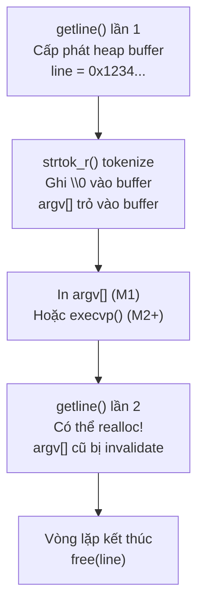

# 🧠 Milestone 1 – Kiến thức cần có

> **Phạm vi M1:** Đọc dòng lệnh → tokenize → xây dựng `argv[]` → in kết quả. Chưa thực thi lệnh.

---

## 1. Con trỏ và chuỗi trong C

### Tại sao cần?
`argv` là mảng các **con trỏ** trỏ vào **cùng một buffer** mà `getline()` cấp phát. Hiểu sai điều này sẽ gây lỗi use-after-free hoặc dữ liệu bị ghi đè.

### Kiến thức cần nắm

| Khái niệm | Giải thích |
|---|---|
| `char *p` | Con trỏ tới ký tự đầu tiên của chuỗi |
| `char **argv` | Mảng con trỏ chuỗi (double pointer) |
| `argv[argc] = NULL` | Terminator bắt buộc cho `execvp()` |
| Buffer lifetime | Buffer sống đến khi `free(line)` hoặc `getline()` tái cấp phát |

### Minh họa bộ nhớ

```
Buffer (heap):  "ls\0-l\0/tmp\0"
                 ↑     ↑     ↑
argv[0]─────────┘     │     │
argv[1]───────────────┘     │
argv[2]─────────────────────┘
argv[3] = NULL
```

> [!WARNING]
> `strtok_r()` **ghi đè** ký tự phân cách bằng `\0` trực tiếp vào buffer. `argv[i]` chỉ là pointer vào buffer đó — không phải bản sao.

---

## 2. `getline()` – Đọc dòng lệnh

### Prototype

```c
#include <stdio.h>

ssize_t getline(char **lineptr, size_t *n, FILE *stream);
```

### Tham số

| Tham số | Ý nghĩa |
|---|---|
| `lineptr` | Địa chỉ của con trỏ buffer. `getline()` tự realloc nếu cần. |
| `n` | Địa chỉ của kích thước buffer hiện tại |
| `stream` | Luồng đọc (dùng `stdin`) |
| **Trả về** | Số byte đọc được (kể cả `\n`), hoặc `-1` nếu EOF/lỗi |

### Mẫu sử dụng đúng

```c
char   *line     = NULL;  /* getline() tự cấp phát */
size_t  capacity = 0;     /* getline() tự điều chỉnh */

fputs("minish> ", stdout);
fflush(stdout);           /* phải flush trước khi block đọc */

ssize_t len = getline(&line, &capacity, stdin);

if (len == -1) {
    /* EOF (Ctrl+D) hoặc lỗi */
    free(line);
    break; /* thoát vòng lặp */
}
/* line chứa "\n" ở cuối — strtok_r sẽ bỏ nó */
```

### Các điểm dễ nhầm

| Lỗi thường gặp | Cách đúng |
|---|---|
| Khởi tạo `line = ""` | Phải là `line = NULL` |
| Bỏ qua `fflush(stdout)` | Prompt không hiện trước khi nhập |
| Không `free(line)` | Memory leak sau khi thoát |
| Check `len == 0` cho EOF | Phải check `len == -1` |

---

## 3. `strtok_r()` – Tokenize (thread-safe)

### Prototype

```c
#include <string.h>

char *strtok_r(char *str, const char *delim, char **saveptr);
```

### Cách hoạt động

1. Lần gọi đầu: `str` = con trỏ buffer, `saveptr` lưu vị trí.
2. Các lần gọi tiếp: `str = NULL`, hàm tiếp tục từ `saveptr`.
3. Trả về `NULL` khi hết token.
4. **Ghi `\0`** vào vị trí phân cách — buffer bị sửa.

### Mẫu tokenize hoàn chỉnh

```c
static int parse_command(char *line, Command *cmd) {
    memset(cmd, 0, sizeof(*cmd));
    char *saveptr = NULL;

    for (char *tok = strtok_r(line, " \t\r\n", &saveptr);
         tok != NULL;
         tok = strtok_r(NULL, " \t\r\n", &saveptr))
    {
        if (cmd->argc >= MAX_ARGS) {
            fprintf(stderr, "minish: too many arguments\n");
            return -1;
        }
        cmd->argv[cmd->argc++] = tok;
        cmd->argv[cmd->argc]   = NULL; /* luôn cập nhật terminator */
    }

    return (cmd->argc > 0) ? 1 : 0;
    /*     1 = có lệnh      0 = dòng trống   -1 = lỗi */
}
```

### Tại sao dùng `strtok_r` chứ không phải `strtok`?

`strtok()` dùng biến static nội bộ → không an toàn khi gọi lồng nhau.  
`strtok_r()` dùng `saveptr` do caller cung cấp → an toàn.

---

## 4. Struct `Command` và `argv[]`

### Định nghĩa

```c
#define MAX_ARGS  32
#define MAX_LINE  4096

typedef struct {
    char *argv[MAX_ARGS + 1]; /* +1 cho NULL terminator */
    int   argc;               /* số lượng argument */
} Command;
```

### Quy tắc bất biến

```
argv[argc] == NULL         ← luôn đúng
argv[0]    == tên lệnh     ← "ls", "echo", ...
argc       >= 1            ← nếu có lệnh hợp lệ
```

### Kiểm tra sau tokenize

```c
Command cmd;
int result = parse_command(line, &cmd);
if (result == 1) {
    printf("argc = %d\n", cmd.argc);
    for (int i = 0; i < cmd.argc; i++)
        printf("argv[%d] = \"%s\"\n", i, cmd.argv[i]);
}
```

---

## 5. Vòng lặp chính (REPL)

### Cấu trúc tổng thể M1

```c
int main(void) {
    char   *line     = NULL;
    size_t  capacity = 0;

    while (1) {
        /* 1. Hiển thị prompt */
        fputs("minish> ", stdout);
        fflush(stdout);

        /* 2. Đọc lệnh */
        ssize_t len = getline(&line, &capacity, stdin);
        if (len == -1) break; /* EOF */

        /* 3. Kiểm tra độ dài */
        if (len > MAX_LINE) {
            fprintf(stderr, "minish: line too long\n");
            continue;
        }

        /* 4. Tokenize */
        Command cmd;
        int result = parse_command(line, &cmd);

        if (result == 0)  continue; /* dòng trống */
        if (result == -1) continue; /* lỗi parse */

        /* 5. In kết quả (M1 chưa thực thi) */
        printf("argc=%d\n", cmd.argc);
        for (int i = 0; i < cmd.argc; i++)
            printf("  argv[%d]=\"%s\"\n", i, cmd.argv[i]);
    }

    /* 6. Cleanup */
    free(line);
    return 0;
}
```

---

## 6. Xử lý lỗi và edge cases

### Bảng kiểm tra M1

| Input | Hành vi mong đợi |
|---|---|
| `ls -l /tmp` | argc=3, argv[0]="ls", argv[1]="-l", argv[2]="/tmp" |
| `   echo   hello  ` | argc=2 (khoảng trắng thừa bị bỏ) |
| *(dòng trống)* | Không in gì, hiện prompt tiếp |
| Ctrl+D | Thoát sạch |
| 33 arguments | Báo lỗi "too many arguments", bỏ qua lệnh |
| Dòng > 4096 byte | Báo lỗi "line too long", bỏ qua |

### Giá trị trả về của `parse_command()`

```
 1  → lệnh hợp lệ, có ít nhất 1 token
 0  → dòng trống / chỉ có whitespace
-1  → lỗi (quá nhiều argument, v.v.)
```

---

## 7. Quản lý bộ nhớ

### Vòng đời của buffer



> [!CAUTION]
> Sau khi `getline()` được gọi lần tiếp theo, các con trỏ trong `argv[]` từ lần trước có thể bị invalidate nếu buffer bị realloc. Luôn parse lại sau mỗi lần đọc.

---

## 8. Compile và test M1

```bash
# Biên dịch với cảnh báo đầy đủ
gcc -Wall -Wextra -o minish_m1 minish_m1.c

# Chạy thử
./minish_m1

# Kiểm tra leak (Linux)
valgrind --leak-check=full ./minish_m1
```

### Checklist hoàn thành M1

- [ ] `fputs` + `fflush` hiển thị prompt
- [ ] `getline(&line, &capacity, stdin)` đọc đúng
- [ ] `parse_command()` tokenize với `strtok_r()`
- [ ] `argv[argc] == NULL` luôn đúng
- [ ] Dòng trống → `continue`
- [ ] EOF → `break` → `free(line)` → `return 0`
- [ ] > 32 args → báo lỗi, `continue`
- [ ] > 4096 byte → báo lỗi, `continue`
- [ ] Biên dịch sạch với `-Wall -Wextra`

---

## Bổ sung: Header cần include

```c
#include <stdio.h>    /* fputs, fflush, getline, fprintf, printf, perror */
#include <stdlib.h>   /* free, getenv */
#include <string.h>   /* strtok_r, memset, strlen */
#include <stdbool.h>  /* bool (dùng từ M3) */
/* M2+ */
#include <unistd.h>   /* fork, execvp, chdir, _exit, dup2, close, pipe */
#include <sys/types.h>/* pid_t */
#include <sys/wait.h> /* waitpid */
#include <fcntl.h>    /* open, O_RDONLY, O_WRONLY, O_CREAT, O_TRUNC */
#include <errno.h>    /* errno, EINTR */
```
