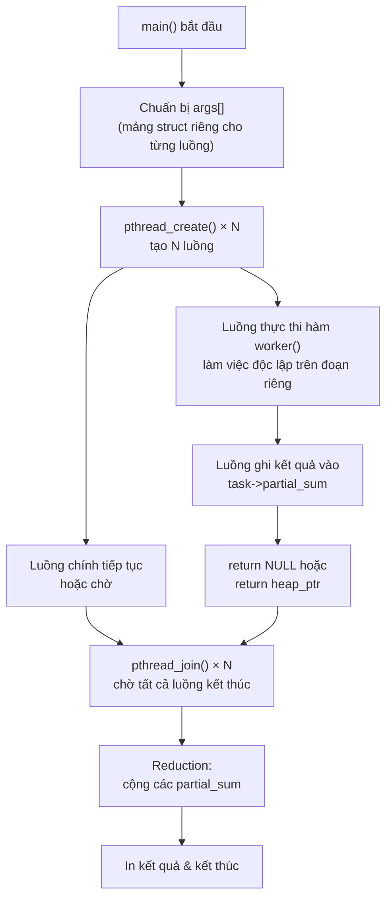

# Lab 9 – Lập Trình Đa Luồng với Pthreads

> **Biên dịch chuẩn:** `gcc -Wall -Wextra -std=c11 -pthread file.c -o file`
> ⚠️ **Lưu ý Lab 9:** Chưa dùng mutex/semaphore — race condition là hiện tượng cần **quan sát và giải thích**, không phải sửa.

---

## 1. SYNTAX CÁC HÀM CỐT LÕI

### 1.1 `pthread_create` — Tạo luồng mới

```c
#include <pthread.h>
#include <string.h>  // strerror()

int pthread_create(pthread_t *thread,         // OUT: ID của luồng mới
                   const pthread_attr_t *attr, // NULL = mặc định
                   void *(*start_routine)(void *), // Hàm luồng thực thi
                   void *arg);                // Dữ liệu truyền vào

// Trả về 0 nếu OK, mã lỗi dương nếu thất bại
// Dùng strerror(rc) để in lỗi, KHÔNG dùng perror()
```

**Mẫu kiểm tra lỗi:**
```c
pthread_t tid;
int rc = pthread_create(&tid, NULL, worker, arg);
if (rc != 0) {
    fprintf(stderr, "pthread_create: %s\n", strerror(rc));
    return 1;
}
```

---

### 1.2 `pthread_join` — Chờ luồng kết thúc

```c
int pthread_join(pthread_t thread,  // ID luồng cần chờ
                 void **retval);    // Nhận kết quả trả về; NULL nếu không cần

// Trả về 0 nếu OK
```

**Mẫu:**
```c
void *result = NULL;
pthread_join(tid, &result);    // Có nhận kết quả
pthread_join(tid, NULL);       // Không cần kết quả
```

---

### 1.3 Hàm luồng — Chữ ký bắt buộc

```c
// Hàm luồng PHẢI có dạng: void *tên_hàm(void *arg)
void *worker(void *arg) {
    // Ép kiểu arg sang kiểu dữ liệu thực
    int n = *(int *)arg;

    /* ... làm việc ... */

    return NULL;              // Kết thúc bình thường, không trả kết quả
    // Hoặc: return result;   // Trả con trỏ đến kết quả trên heap
    // Hoặc: pthread_exit(result);
}
```

---

### 1.4 `pthread_self` và `pthread_equal`

```c
pthread_t my_id = pthread_self();             // Lấy ID của luồng hiện tại

// So sánh 2 ID luồng (KHÔNG dùng ==)
if (pthread_equal(t1, t2)) { /* cùng luồng */ }
```

---

### 1.5 Đo thời gian với `clock_gettime`

```c
#include <time.h>

struct timespec start, end;
clock_gettime(CLOCK_MONOTONIC, &start);

/* ... code cần đo ... */

clock_gettime(CLOCK_MONOTONIC, &end);
double elapsed = (end.tv_sec  - start.tv_sec)
               + (end.tv_nsec - start.tv_nsec) / 1e9;
printf("Elapsed: %.4f s\n", elapsed);
```

---

## 2. PATTERN TRUYỀN DỮ LIỆU

### 2.1 Truyền 1 giá trị (int, long...)

```c
// ĐÚNG: Dùng mảng để mỗi luồng có biến riêng
int ids[4] = {0, 1, 2, 3};
for (int i = 0; i < 4; i++)
    pthread_create(&tids[i], NULL, worker, &ids[i]);

// SAI: Truyền &i — tất cả luồng thấy cùng biến i đang thay đổi
for (int i = 0; i < 4; i++)
    pthread_create(&tids[i], NULL, worker, &i);  // ❌ BUG
```

### 2.2 Truyền nhiều giá trị qua struct

```c
typedef struct {
    int    id;      // Số thứ tự luồng
    char  *message; // Thông điệp
} ThreadArgs;

void *worker(void *arg) {
    ThreadArgs *a = (ThreadArgs *)arg;
    printf("Thread %d: %s\n", a->id, a->message);
    return NULL;
}

// Khởi tạo và truyền
ThreadArgs args[3] = {
    {1, "Hello"}, {2, "World"}, {3, "!"}
};
pthread_create(&tids[0], NULL, worker, &args[0]);
pthread_create(&tids[1], NULL, worker, &args[1]);
pthread_create(&tids[2], NULL, worker, &args[2]);
```

### 2.3 Nhận kết quả từ luồng (heap)

```c
void *compute_sum(void *arg) {
    int n = *(int *)arg;
    long long *result = malloc(sizeof(*result));  // Cấp phát trên heap
    if (!result) return NULL;
    *result = 0;
    for (int i = 1; i <= n; i++) *result += i;
    return result;   // Trả về con trỏ heap (vẫn hợp lệ sau khi luồng kết thúc)
}

int main(void) {
    pthread_t tid;
    int n = 10;
    void *retval = NULL;
    pthread_create(&tid, NULL, compute_sum, &n);
    pthread_join(tid, &retval);
    if (retval) {
        long long *sum = retval;
        printf("Sum = %lld\n", *sum);  // Sum = 55
        free(sum);  // Giải phóng bộ nhớ
    }
    return 0;
}
```

> [!CAUTION]
> **KHÔNG** trả về địa chỉ biến cục bộ trong hàm luồng. Stack của luồng không còn hợp lệ sau khi hàm return.
> ```c
> void *bad_thread(void *arg) {
>     int result = 42;
>     return &result;  // ❌ NGUY HIỂM: stack bị thu hồi sau return
> }
> ```

---

## 3. PATTERN CHIA VIỆC & REDUCTION

### 3.1 Struct nhiệm vụ chuẩn

```c
typedef struct {
    const long *array;   // Con trỏ đến mảng dữ liệu (dùng chung, chỉ đọc)
    size_t      begin;   // Chỉ số bắt đầu (inclusive)
    size_t      end;     // Chỉ số kết thúc (exclusive)
    long long   partial_sum;  // Kết quả của đoạn này (mỗi luồng ghi vào phần riêng)
} Task;
```

### 3.2 Công thức chia đều mảng (không cần xử lý phần dư)

```c
#define N_THREADS 4
size_t N = 1000000;

Task tasks[N_THREADS];
for (int i = 0; i < N_THREADS; i++) {
    tasks[i].array = array;
    tasks[i].begin = (i * N) / N_THREADS;         // Bắt đầu đoạn i
    tasks[i].end   = ((i + 1) * N) / N_THREADS;   // Kết thúc đoạn i
}
// N=10, T=4: Đoạn 0:[0,2), Đoạn 1:[2,5), Đoạn 2:[5,7), Đoạn 3:[7,10)
```

### 3.3 Hàm luồng và reduction

```c
void *sum_range(void *arg) {
    Task *task = (Task *)arg;
    long long sum = 0;
    for (size_t i = task->begin; i < task->end; i++)
        sum += task->array[i];
    task->partial_sum = sum;   // Ghi vào phần riêng của task → không race
    return NULL;
}

// Luồng chính: Thu thập và cộng lại (reduction)
long long total = 0;
for (int i = 0; i < N_THREADS; i++) {
    pthread_join(tids[i], NULL);
    total += tasks[i].partial_sum;  // An toàn vì đã join xong
}
printf("Total sum = %lld\n", total);
```

---

## 4. RACE CONDITION — Quan sát (Bài 7)

```c
// ⚠️ Chương trình CÓ RACE CONDITION — chủ ý để quan sát
#define LOOPS 1000000
long counter = 0;  // Biến dùng chung — KHÔNG được bảo vệ

void *worker(void *arg) {
    (void)arg;
    for (long i = 0; i < LOOPS; i++)
        counter++;  // counter++ gồm: ĐỌC → TÍNH → GHI (không nguyên tử!)
    return NULL;
}

// Hai luồng cùng chạy → kết quả KHÔNG phải lúc nào cũng là 2*LOOPS
// Giải thích: Hai luồng có thể cùng đọc counter=X, cùng tính X+1, cùng ghi X+1
// → Mất 1 lần tăng → kết quả < 2*LOOPS
```

**Giải thích race condition bằng lời:**
```
Mong đợi: 2 * 1,000,000 = 2,000,000
Thực tế:  1,756,432  (thay đổi mỗi lần chạy)

Nguyên nhân: counter++ không nguyên tử:
  Thread A đọc counter = 100
  Thread B đọc counter = 100  (trước khi A kịp ghi)
  Thread A tính 100+1=101, ghi 101
  Thread B tính 100+1=101, ghi 101  ← Mất 1 lần tăng!
  Kết quả: 101 thay vì 102
```

---

## 5. BẢNG SO SÁNH THREAD vs PROCESS

| Đặc điểm | Thread (cùng process) | Process (fork) |
|-----------|----------------------|----------------|
| Không gian địa chỉ | **Dùng chung** | Tách biệt |
| Biến toàn cục | **Dùng chung** (→ race condition) | Mỗi process có bản riêng |
| Heap | **Dùng chung** | Tách biệt |
| Stack | Mỗi luồng có riêng | Mỗi process có riêng |
| Trao đổi dữ liệu | Trực tiếp qua biến | Cần IPC (pipe, FIFO...) |
| Chi phí tạo | Thấp hơn | Cao hơn |

**Minh chứng qua code (Bài 4):**
```c
int shared_var = 5;

// --- Phiên bản Thread: shared_var ĐƯỢC CHIA SẺ ---
void *thread_fn(void *arg) { shared_var = 10; return NULL; }
// Sau join: shared_var == 10  ← Thread sửa được biến của main

// --- Phiên bản Process: shared_var ĐỘC LẬP ---
// Con: shared_var = 10; exit();
// Cha: waitpid(); printf("%d", shared_var); → In ra 5  ← Không bị ảnh hưởng
```

---

## 6. FLOW DIAGRAM



---

## 7. HƯỚNG DẪN TỪNG BÀI

---

### 🔹 Bài 1 — Tạo và chờ một luồng

**Ý tưởng:** Luồng mới in số 1..N; luồng chính chờ bằng `pthread_join` rồi in `Main thread exiting.`

```c
#include <stdio.h>
#include <string.h>
#include <pthread.h>

void *print_numbers(void *arg) {
    int n = *(int *)arg;
    for (int i = 1; i <= n; i++)
        printf("%d\n", i);
    return NULL;
}

int main(void) {
    int n;
    printf("Nhap so nguyen duong N: ");
    scanf("%d", &n);

    pthread_t tid;
    int rc = pthread_create(&tid, NULL, print_numbers, &n);
    if (rc != 0) { fprintf(stderr, "pthread_create: %s\n", strerror(rc)); return 1; }

    rc = pthread_join(tid, NULL);
    if (rc != 0) { fprintf(stderr, "pthread_join: %s\n", strerror(rc)); return 1; }

    printf("Main thread exiting.\n");
    return 0;
}
```

**Kết quả (N=5):**
```
1  2  3  4  5
Main thread exiting.
```

---

### 🔹 Bài 2 — Nhận kết quả từ luồng (tính tổng 1..N)

**Ý tưởng:** Luồng tính tổng, lưu vào heap, trả về qua `return`. Main nhận qua `pthread_join`.

```c
#include <stdio.h>
#include <stdlib.h>
#include <pthread.h>

void *compute_sum(void *arg) {
    int n = *(int *)arg;
    long long *result = malloc(sizeof(*result));
    if (!result) return NULL;
    *result = 0;
    for (int i = 1; i <= n; i++) *result += i;
    return result;        // Trả về con trỏ heap
}

int main(void) {
    int n;
    printf("Nhap N: ");
    scanf("%d", &n);

    pthread_t tid;
    pthread_create(&tid, NULL, compute_sum, &n);

    void *retval = NULL;
    pthread_join(tid, &retval);       // Nhận con trỏ heap
    if (retval) {
        printf("Sum = %lld\n", *(long long *)retval);
        free(retval);                 // Giải phóng heap
    }
    return 0;
}
```

**Kết quả (N=10):** `Sum = 55`

> [!TIP]
> Luôn `free()` vùng nhớ được luồng cấp phát và trả về — tránh memory leak.

---

### 🔹 Bài 3 — Truyền tham số cho nhiều luồng

**Ý tưởng:** 3 luồng, mỗi luồng nhận `{id, message}` riêng qua mảng struct. Luồng chính cũng in song song.

```c
#include <stdio.h>
#include <pthread.h>

typedef struct { int id; const char *message; } Args;

void *worker(void *arg) {
    Args *a = (Args *)arg;
    printf("Thread %d: %s\n", a->id, a->message);
    return NULL;
}

int main(void) {
    pthread_t tids[3];
    // Mảng args — không dùng biến vòng lặp làm tham số trực tiếp
    Args args[3] = {{1,"Hello"}, {2,"World"}, {3,"Done"}};

    for (int i = 0; i < 3; i++)
        pthread_create(&tids[i], NULL, worker, &args[i]);

    printf("Main thread is running.\n");

    for (int i = 0; i < 3; i++)
        pthread_join(tids[i], NULL);

    printf("All threads finished.\n");
    return 0;
}
```

**Quan sát:** Chạy nhiều lần — thứ tự in của 3 luồng **không cố định**.

---

### 🔹 Bài 4 — So sánh Thread vs Process

**Phiên bản Thread (`bai4_thread.c`):**
```c
#include <stdio.h>
#include <pthread.h>

int shared_var = 5;

void *fn(void *arg) { (void)arg; shared_var = 10; return NULL; }

int main(void) {
    pthread_t tid;
    pthread_create(&tid, NULL, fn, NULL);
    pthread_join(tid, NULL);
    printf("shared_var = %d\n", shared_var);  // In ra: 10
    // → Thread sửa được biến của luồng chính (cùng không gian địa chỉ)
    return 0;
}
```

**Phiên bản Process (`bai4_process.c`):**
```c
#include <stdio.h>
#include <sys/wait.h>
#include <unistd.h>

int shared_var = 5;

int main(void) {
    pid_t pid = fork();
    if (pid == 0) {
        shared_var = 10;
        printf("Child: shared_var = %d\n", shared_var);  // In ra: 10
        _exit(0);
    }
    waitpid(pid, NULL, 0);
    printf("Parent: shared_var = %d\n", shared_var);    // In ra: 5
    // → Process con không ảnh hưởng được biến của process cha
    return 0;
}
```

**Giải thích:** Thread dùng chung không gian địa chỉ → sửa được biến nhau. Process sau `fork()` có không gian địa chỉ riêng (copy-on-write) → độc lập.

---

### 🔹 Bài 5 — Tính tổng mảng song song (Reduction)

**Ý tưởng:** 4 luồng, mỗi luồng tính `partial_sum` trên đoạn riêng. Main cộng lại.

```c
#include <stdio.h>
#include <stdlib.h>
#include <pthread.h>

#define N         1000000
#define N_THREADS 4

typedef struct {
    const long *array;
    size_t      begin, end;
    long long   partial_sum;
} Task;

void *sum_range(void *arg) {
    Task *t = (Task *)arg;
    long long s = 0;
    for (size_t i = t->begin; i < t->end; i++) s += t->array[i];
    t->partial_sum = s;
    return NULL;
}

int main(void) {
    // Tạo mảng: a[i] = i + 1
    long *a = malloc(N * sizeof(long));
    for (size_t i = 0; i < N; i++) a[i] = (long)(i + 1);

    pthread_t tids[N_THREADS];
    Task tasks[N_THREADS];

    for (int i = 0; i < N_THREADS; i++) {
        tasks[i].array = a;
        tasks[i].begin = (size_t)(i * N) / N_THREADS;
        tasks[i].end   = (size_t)((i + 1) * N) / N_THREADS;
        pthread_create(&tids[i], NULL, sum_range, &tasks[i]);
    }

    long long total = 0;
    for (int i = 0; i < N_THREADS; i++) {
        pthread_join(tids[i], NULL);
        total += tasks[i].partial_sum;      // Reduction
    }

    long long expected = (long long)N * (N + 1) / 2;
    printf("Total   = %lld\n", total);
    printf("Expected= %lld\n", expected);
    printf("%s\n", total == expected ? "CORRECT" : "WRONG");

    free(a);
    return 0;
}
```

---

### 🔹 Bài 6 — So sánh 1 luồng vs 4 luồng (đo thời gian)

**Thêm phần đo thời gian vào bài 5:**

```c
#include <time.h>

// CPU-bound work: lặp nhiều lần phép tính trên mỗi phần tử
static long compute(long x) {
    for (int k = 0; k < 1000; k++) x = x * 1000003 + 1;
    return x;
}

// Phiên bản 1 luồng
struct timespec t0, t1;
clock_gettime(CLOCK_MONOTONIC, &t0);
for (size_t i = 0; i < N; i++) out[i] = compute(a[i]);
clock_gettime(CLOCK_MONOTONIC, &t1);
double serial = (t1.tv_sec - t0.tv_sec) + (t1.tv_nsec - t0.tv_nsec) / 1e9;

// Phiên bản 4 luồng (tương tự bài 5 nhưng gọi compute())
clock_gettime(CLOCK_MONOTONIC, &t0);
// ... tạo 4 luồng ...
// ... join 4 luồng ...
clock_gettime(CLOCK_MONOTONIC, &t1);
double parallel = (t1.tv_sec - t0.tv_sec) + (t1.tv_nsec - t0.tv_nsec) / 1e9;

printf("Serial  : %.4f s\n", serial);
printf("Parallel: %.4f s\n", parallel);
printf("Speedup : %.2fx\n", serial / parallel);
```

> [!NOTE]
> Chạy ít nhất 3-5 lần để có số đo ổn định. Kết quả phụ thuộc số lõi CPU — trên máy ít lõi, song song có thể không nhanh hơn nhiều do overhead `pthread_create`.

---

### 🔹 Bài 7 — Quan sát Race Condition

```c
#include <stdio.h>
#include <pthread.h>

#define LOOPS 1000000
long counter = 0;  // ⚠️ KHÔNG có mutex — race condition có chủ ý

void *worker(void *arg) {
    (void)arg;
    for (long i = 0; i < LOOPS; i++)
        counter++;  // Đọc–Tính–Ghi: KHÔNG nguyên tử
    return NULL;
}

int main(void) {
    pthread_t t1, t2;
    pthread_create(&t1, NULL, worker, NULL);
    pthread_create(&t2, NULL, worker, NULL);
    pthread_join(t1, NULL);
    pthread_join(t2, NULL);
    printf("Expected: %ld\n", 2 * LOOPS);
    printf("Actual  : %ld\n", counter);
    return 0;
}
```

**Chạy 5 lần và ghi kết quả:**
```bash
for i in {1..5}; do ./ex7; echo "---"; done
```

**Kết quả mẫu:**
```
Expected: 2000000  Actual: 1,834,201
Expected: 2000000  Actual: 1,956,088
Expected: 2000000  Actual: 2,000,000  ← Đôi khi đúng (tình cờ)
Expected: 2000000  Actual: 1,712,445
Expected: 2000000  Actual: 1,890,331
```

**Giải thích:** `counter++` gồm 3 bước ở cấp máy: (1) Load, (2) Add 1, (3) Store. Hai luồng có thể Load cùng lúc, cả hai cùng thấy cùng giá trị cũ, dẫn đến mất cập nhật.

---

## 8. LỆNH BIÊN DỊCH & CHẠY

```bash
# Biên dịch chuẩn (cần -pthread)
gcc -Wall -Wextra -std=c11 -pthread ex1.c -o ex1 && ./ex1

# Biên dịch tất cả ex1–ex7
for i in {1..7}; do gcc -Wall -Wextra -std=c11 -pthread "ex${i}.c" -o "ex${i}" && echo "ex${i} OK"; done

# Bài 4: Hai file riêng
gcc -Wall -Wextra -std=c11 -pthread bai4_thread.c  -o bai4_thread
gcc -Wall -Wextra -std=c11             bai4_process.c -o bai4_process

# Bài 7: Chạy nhiều lần để quan sát race
for i in {1..5}; do ./ex7; done

# Dọn dẹp
rm -f ex1 ex2 ex3 ex4 ex5 ex6 ex7 bai4_thread bai4_process
```
